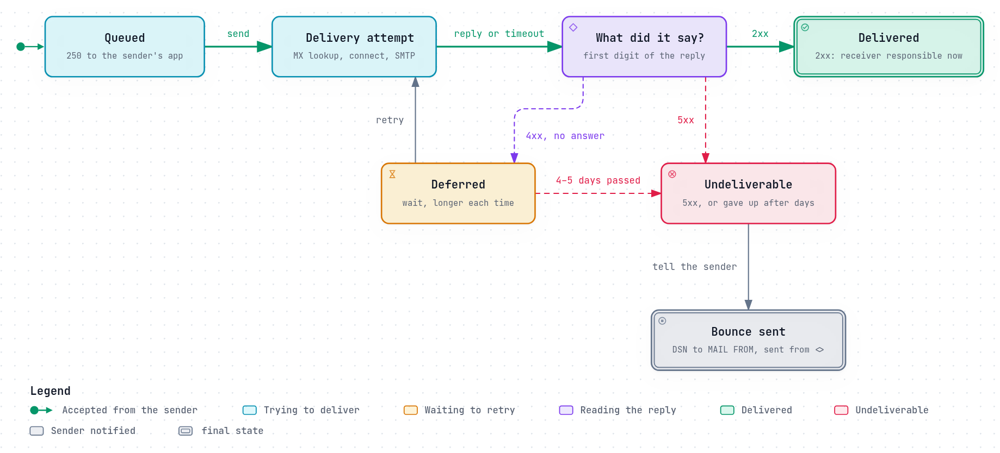

# Bounces, queues and retries

Email is not instant, and was never meant to be. When Bob's server is down, busy,
or not sure about a message yet, Alice's server does not give up. It keeps the
message in its **queue** and tries again, for days. Only when it is sure the
message cannot be delivered does it send Alice a **bounce**: a message
explaining what went wrong.

That patience is one of email's great strengths. It also needs rules, because a
server that gives up too soon loses mail, one that never gives up fills its
disk, and one that sends bounces carelessly floods innocent people with them.



*The diagram's source is [`queue.lifecycle.json`](../diagrams/queue.lifecycle.json).*

## For now, or for good

Every attempt ends with a reply from the receiving server, and its first digit
decides what happens next ([SMTP as a conversation](smtp-conversation.md#reading-the-replies)):

- **`2xx`:** delivered. The message leaves the queue.
- **`4xx`:** a temporary failure. The receiver is busy, greylisting, short of
  disk, or could not check something. The message stays queued and is tried
  again later.
- **`5xx`:** a permanent failure. No such mailbox, refused by policy, message
  too big. The sender is told at once.
- **No reply at all:** the connection failed or timed out. Treated as
  temporary.

## How long to keep trying

[RFC 5321 §4.5.4.1](https://www.rfc-editor.org/rfc/rfc5321#section-4.5.4.1)
sets the expectations:

> In general, the retry interval SHOULD be at least 30 minutes; however, more
> sophisticated and variable strategies will be beneficial when the SMTP client
> can determine the reason for non-delivery.
>
> Retries continue until the message is transmitted or the sender gives up; the
> give-up time generally needs to be at least 4-5 days.

Postfix, for example, waits at least 5 minutes between attempts and at most
4000 seconds (about 67 minutes), and gives up after 5 days
([postconf(5)](https://www.postfix.org/postconf.5.html#maximal_queue_lifetime):
`minimal_backoff_time = 300s`, `maximal_backoff_time = 4000s`,
`maximal_queue_lifetime = 5d`).

Five days covers the ordinary disasters: a server down over a long weekend, a
DNS mistake fixed on Monday, a full mailbox emptied after a holiday.

## The bounce

When a message cannot be delivered, the server sends a **delivery status
notification (DSN)** to the envelope sender, the `MAIL FROM` address
([The message itself](the-message.md#the-envelope-and-the-header-are-different-things)).
Its format is standard ([RFC 3464](https://www.rfc-editor.org/rfc/rfc3464)): a
`multipart/report` ([RFC 6522](https://www.rfc-editor.org/rfc/rfc6522)) with
three parts.

1. A text explanation for the person.
2. A machine-readable part, `message/delivery-status`, that programs can act
   on:
   ```
   Reporting-MTA: dns; mail.example.com
   Final-Recipient: rfc822; bob@example.org
   Action: failed
   Status: 5.1.1
   Remote-MTA: dns; mx.example.org
   Diagnostic-Code: smtp; 550 5.1.1 <bob@example.org>: no such user
   ```
3. The original message, or its header.

Two rules keep bounces from making things worse:

- **A bounce is sent with an empty envelope sender, `MAIL FROM:<>`.** So if the
  bounce itself cannot be delivered, nothing bounces back: "if this address is
  null ("<>"), the receiver-SMTP MUST NOT send a notification"
  ([RFC 5321 §6.1](https://www.rfc-editor.org/rfc/rfc5321#section-6.1)).
- **Once a server has said `250`, it must deliver or bounce.** It "MUST NOT
  lose the message for frivolous reasons", and "If there is a delivery failure
  after acceptance of a message, the receiver-SMTP MUST formulate and mail a
  notification message" (the same section). Silently dropping accepted mail is
  [the black hole](../how-it-goes-wrong/the-black-hole.md).

A sender can ask for more with the `DSN` extension
([RFC 3461](https://www.rfc-editor.org/rfc/rfc3461)): `NOTIFY=SUCCESS` for a
report when delivery succeeds, `NOTIFY=DELAY` for a warning while it is still
queued, or `NOTIFY=NEVER` for none.

## Refuse, don't bounce

There are two ways to say no to a message for a mailbox that does not exist:

- **Refuse it during the conversation**, with `550 5.1.1` to `RCPT TO`. The
  sending server keeps the message and writes the bounce to its own user, who is
  real, because they had to sign in to send.
- **Accept it, then bounce it.** Now your server writes a bounce to whatever
  `MAIL FROM` the sender claimed. Spam forges that address. Your bounces land on
  an innocent person, by the thousand.

The second is called **backscatter**. Postfix's documentation describes it from
the victim's side: "When a spammer or worm sends mail with forged sender
addresses, innocent sites are flooded with undeliverable mail notifications"
([BACKSCATTER_README](https://www.postfix.org/BACKSCATTER_README.html)). The cure
is to decide during the conversation: know your recipients at `RCPT TO`, and
reject spam and viruses before the final `250`, not after.

## Automatic replies

Vacation messages and other auto-replies are bounces' cousins, with the same
risks, and a standard of their own ([RFC 3834](https://www.rfc-editor.org/rfc/rfc3834)):

- **Mark them** with `Auto-Submitted: auto-replied`, so other responders do not
  answer back.
- **Never reply to `<>`.** "Responders MUST NOT generate any response for which
  the destination of that response would be a null address"
  ([§2](https://www.rfc-editor.org/rfc/rfc3834#section-2)).
- **Reply once per sender per period,** not to every message. Sieve's vacation
  extension defaults to 7 days ([RFC 5230](https://www.rfc-editor.org/rfc/rfc5230#section-4.1)).
- **Send them with an empty envelope sender too**
  ([RFC 5230 §5.1](https://www.rfc-editor.org/rfc/rfc5230#section-5.1)).

## What goes wrong

- **A queue full of spam bounces,** the first visible sign of an
  [open relay](../how-it-goes-wrong/open-relay-and-spam-machine.md).
- **Backscatter,** from accepting first and checking later.
- **`5xx` for a temporary problem,** such as a DNS lookup that timed out at the
  receiver: real mail bounces that a retry would have delivered.
- **`4xx` for a permanent one:** mail to an address that will never exist sits
  in queues for days before the sender hears.
- **Giving up too soon,** before the 4–5 days RFC 5321 expects.
- **Accepted, then dropped:** a filter that discards mail it has already said
  yes to, with no bounce.
- **Auto-reply loops** between two responders that do not mark their mail.

## Look at your own queue

- Postfix: `postqueue -p` lists the queue with each message's last error;
  `postqueue -f` retries everything now; `postcat -q <id>` shows one message.
- Exim: `exim -bp` lists it; `exim -Mvh <id>` shows a message's header.

A queue that keeps growing is a symptom, never the problem: read the errors.

## How REST Mail handles it

- **Retries by reason.** The queue classifies each failure and retries on a
  schedule for that reason, which is the "more sophisticated" strategy RFC 5321
  allows: greylisting is retried after 7 minutes, a remote asking it to slow
  down after 15, a full mailbox after an hour, a
  TLS problem after 15 minutes, a DNS failure after 5, and anything else after
  1. Each wait doubles, up to 4 hours, with random jitter of a fifth either way
  so that messages held up by the same outage do not all retry at once
  ([`internal/gateway/queue/retry.go`](../../../internal/gateway/queue/retry.go)).
- **How long:** today REST Mail gives up after 72 hours, or 48 for a full
  mailbox. That is shorter than RFC 5321's 4–5 days; bringing it to 5 days is
  [#711](https://github.com/rest-mail/rest-mail-server/issues/711).
- **Bounces** are RFC 3464 reports, marked `Auto-Submitted: auto-generated`,
  with `Remote-MTA` and `Last-Attempt-Date`, and with every remote value
  cleaned so a hostile reply cannot inject header lines
  ([`worker.go`](../../../internal/gateway/queue/worker.go), `buildDSNMessage`).
- **Bounces go only where they belong.** A bounce is written straight into the
  sender's own inbox, only if the queued message really came from that mailbox,
  and no more than a set number per mailbox per hour, so a forged sender cannot
  be used to flood someone with bounces.
- **No backscatter from port 25.** REST Mail refuses an unknown recipient with
  `550 5.1.1` during the conversation, and runs its checks before it answers the
  message, so it does not accept mail and bounce it later.
- **Not yet compliant:** when a forward to another server fails for good, the
  bounce to the original sender is dropped
  ([#715](https://github.com/rest-mail/rest-mail-server/issues/715)), and the
  vacation responder can answer a bounce and sends from the user's address
  rather than `<>` ([#716](https://github.com/rest-mail/rest-mail-server/issues/716)).
- **Hard bounces are remembered.** An address that bounces with "no such
  mailbox" is suppressed for 90 days, so REST Mail does not keep sending to it
  ([`suppression.go`](../../../internal/gateway/queue/suppression.go), #141).

## Sources

- [RFC 5321](https://www.rfc-editor.org/rfc/rfc5321):
  [§4.5.4.1](https://www.rfc-editor.org/rfc/rfc5321#section-4.5.4.1) (retries),
  [§6.1](https://www.rfc-editor.org/rfc/rfc5321#section-6.1) (reliable delivery and notifications).
- [RFC 3461](https://www.rfc-editor.org/rfc/rfc3461): the DSN extension.
  [RFC 3464](https://www.rfc-editor.org/rfc/rfc3464): the DSN format.
  [RFC 6522](https://www.rfc-editor.org/rfc/rfc6522): multipart/report.
- [RFC 3834](https://www.rfc-editor.org/rfc/rfc3834): automatic responses.
  [RFC 5230](https://www.rfc-editor.org/rfc/rfc5230): the Sieve vacation extension.
- Postfix: [postconf(5)](https://www.postfix.org/postconf.5.html),
  [BACKSCATTER_README](https://www.postfix.org/BACKSCATTER_README.html).
- REST Mail: [`internal/gateway/queue/`](../../../internal/gateway/queue/),
  [`internal/pipeline/filters/vacation.go`](../../../internal/pipeline/filters/vacation.go).
