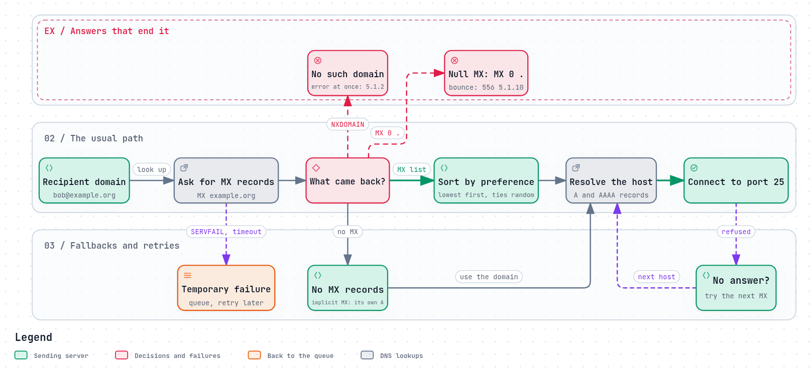

# DNS for email

An email address names a person and a domain, never a server. `bob@example.org`
says nothing about which machine takes Bob's mail. That answer lives in the
DNS, the internet's directory. So does almost everything else a mail server
needs to know about a domain: who may send for it, where its signing keys are,
and what to do with mail that fails its checks.

Get the DNS right and mail flows. Get one record wrong and mail goes to the
wrong place, or nowhere, often without an error anyone sees.



*The diagram's source is [`dns.workflow.json`](../diagrams/dns.workflow.json).*

## MX: where mail for a domain goes

An **MX record** ("mail exchanger") names a server that accepts mail for the
domain, with a preference number:

```
example.org.   3600  IN  MX  10  mx1.example.org.
example.org.   3600  IN  MX  20  mx2.example.org.
```

A sending server sorts the records by preference and tries the **lowest number
first**. Records with the same number must be tried in random order, to spread
the load. If the first server cannot be reached, the next is tried, and a sender
"SHOULD try at least two addresses"
([RFC 5321 §5.1](https://www.rfc-editor.org/rfc/rfc5321#section-5.1)).

Two rules about the name an MX points to:

- **It must be a host name with an address record (A or AAAA)**, not an IP
  address. RFC 5321 requires the answer to "contain a domain name", which
  "MUST return at least one address record".
- **It must not be an alias (CNAME).** "The domain name used as [...] part of
  the value of a MX resource record must not be an alias"
  ([RFC 2181 §10.3](https://www.rfc-editor.org/rfc/rfc2181#section-10.3)).
  Many servers follow one anyway, but not all do.

## When there is no MX

RFC 5321 gives three different answers three different meanings:

| The DNS says | Meaning | What the sender must do |
|---|---|---|
| The domain does not exist (NXDOMAIN) | A typo, or a domain that has gone | Report an error, at once |
| A temporary failure | The DNS could not answer now | Queue the message and retry later |
| The domain exists, with no MX | An old-style domain | Deliver to the domain's own address (A or AAAA), the **implicit MX** |

The implicit MX is a leftover from before MX records existed. It means any
domain with a web server's address seems, to a sending server, to accept mail.
Mail for `info@www.example.com` is delivered to the web server, which usually
refuses the connection, so the message sits in queues for days before it
bounces.

## Null MX: "this domain takes no mail"

A domain that never receives mail can say so with a **null MX**
([RFC 7505](https://www.rfc-editor.org/rfc/rfc7505)):

```
www.example.com.  3600  IN  MX  0  .
```

The `.` is not a host. It means there is no mail exchanger. A sending server
that sees it fails the message straight away, with `556 5.1.10`, instead of
retrying for days. RFC 7505 says what that buys: "Null MX allows a mail system
to report the delivery failure when the user sends the message, rather than
hours or days later", and it lets the bounces of forged spam be "disposed of
efficiently".

Do not publish a null MX for a domain you send from: receivers may reject your
mail, because a reply would have nowhere to go. For a domain that also sends
nothing, add an SPF record of `v=spf1 -all`.

## A, AAAA and reverse DNS

- **A and AAAA** records give the MX host's IPv4 and IPv6 addresses.
- **Reverse DNS** maps an address back to a name, with a **PTR** record. It is
  set by whoever owns the address: your hosting provider or ISP, not your
  domain's DNS host.

Receiving servers check that the connecting address has a PTR record, and that
the name it gives resolves back to the same address ("forward-confirmed reverse
DNS"). Gmail requires it of everyone who sends to it: sending domains and
addresses must have "valid forward and reverse DNS records, also referred to as
PTR records"
([Google, Email sender guidelines](https://support.google.com/a/answer/81126)).
A missing PTR record is one of the most common reasons a new server's mail is
rejected while everything else checks out.

## The records that carry policy

Everything added to email since the 1990s is published in the DNS, mostly as
TXT records under well-known names. Each has a chapter of its own:

| Record | Name | What it says | Chapter |
|---|---|---|---|
| SPF | `example.org` TXT | Which servers may send for the domain | [SPF](../security/spf.md) |
| DKIM key | `<selector>._domainkey.example.org` TXT | The public key that checks signatures | [DKIM](../security/dkim.md) |
| DMARC | `_dmarc.example.org` TXT | What to do with mail that fails, and where to send reports | [DMARC](../security/dmarc.md) |
| MTA-STS | `_mta-sts.example.org` TXT | That a TLS policy is published over HTTPS | [MTA-STS and DANE](../security/mta-sts-and-dane.md) |
| TLS-RPT | `_smtp._tls.example.org` TXT | Where to send reports of TLS failures | [MTA-STS and DANE](../security/mta-sts-and-dane.md) |
| TLSA | `_25._tcp.mx1.example.org` TLSA | The MX's certificate, signed with DNSSEC (DANE) | [MTA-STS and DANE](../security/mta-sts-and-dane.md) |
| SRV | `_imaps._tcp.example.org` and others | Where mail apps connect | [Finding the server](finding-the-server.md) |

Two rules catch people out. A domain must have **only one SPF record**: two make
SPF fail with an error for every message
([RFC 7208 §3.2](https://www.rfc-editor.org/rfc/rfc7208#section-3.2)). And each
of these names is exact: a DMARC record at `dmarc.example.org`, without the
underscore, is simply not found.

## Changes take time

Every record has a **TTL** ("time to live"): how many seconds other servers may
keep a copy before asking again. A change is seen by everyone only once the old
copies have expired. Before moving mail to a new server, lower the TTL of the
MX and address records a day or more ahead, so the switch takes minutes rather
than hours. [Migrating step by step](../landscape/migrating.md) does this in
order.

## What goes wrong

- **The MX points at the wrong host** after a move, or at a name with no A
  record. Mail queues on senders' servers for days, then bounces.
- **The MX points at a CNAME,** which some servers follow and others refuse.
- **No PTR record,** or one left at the provider's default name. Large
  providers reject or junk the mail.
- **Two SPF records,** often one added by each service the domain uses. SPF
  fails for everything.
- **A record in the wrong place:** at `dmarc.` instead of `_dmarc.`, or with the
  domain repeated by a DNS host that appends it (`_dmarc.example.org.example.org`).
- **A long TTL during a migration,** so half the internet still delivers to the
  old server.

## How to check your own domain

```sh
dig +short MX example.org                 # where mail goes, with preferences
dig +short A mx1.example.org              # the MX host's address
dig +short -x 203.0.113.25                # its reverse DNS (PTR)
dig +short TXT example.org                # SPF (look for exactly one v=spf1)
dig +short TXT _dmarc.example.org         # DMARC
```

The PTR should name the MX host, and that name's A record should be the same
address.

## How REST Mail handles it

- **It prints the records a domain needs, and checks them.** For each domain,
  `chore dns:show` lists the mail host's A record, the MX, an SPF record
  (`v=spf1 mx -all`, naming the MX rather than an address, so moving the server
  changes one A record), a DMARC record at `p=reject`, the DKIM key, and the
  PTR to ask the address's owner for. `chore dns:check` compares them with what
  is published ([`internal/dns/mail_records.go`](../../../internal/dns/mail_records.go)).
- **The server never configures its own public address.** It comes from
  wherever the server is exposed, so records that need it are left out rather
  than guessed.
- **Null MX is honoured:** mail to a domain with `MX 0 .` fails at once with
  `556 5.1.10`, as RFC 7505 asks
  ([`internal/gateway/queue/worker.go`](../../../internal/gateway/queue/worker.go)).
- **Implicit MX** is used for a domain without MX records. Today REST Mail
  cannot tell that case from a domain that does not exist, so mail to a
  misspelled domain is retried until it expires. Fixing that, as RFC 5321
  requires, is [#713](https://github.com/rest-mail/rest-mail-server/issues/713).
- **International domain names** are looked up in their ASCII form (`xn--…`),
  while the queue keeps the Unicode form for display (#153).
- **SRV records** for mail apps are not yet in the printed set, and the list in
  the code names ports REST Mail does not listen on. Both are
  [#712](https://github.com/rest-mail/rest-mail-server/issues/712).

## Sources

- [RFC 5321 §5.1](https://www.rfc-editor.org/rfc/rfc5321#section-5.1): locating the target host.
- [RFC 2181 §10.3](https://www.rfc-editor.org/rfc/rfc2181#section-10.3): MX and NS records must not be aliases.
- [RFC 7505](https://www.rfc-editor.org/rfc/rfc7505): a "Null MX" No Service Resource Record.
- [RFC 7208 §3.2](https://www.rfc-editor.org/rfc/rfc7208#section-3.2): only one SPF record.
- Google: [Email sender guidelines](https://support.google.com/a/answer/81126).
- REST Mail: [`internal/dns/`](../../../internal/dns/),
  [`internal/gateway/queue/worker.go`](../../../internal/gateway/queue/worker.go).
