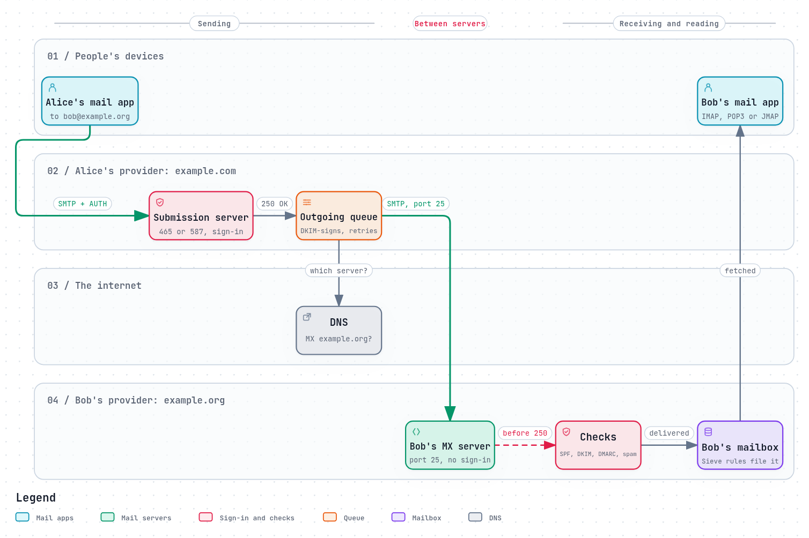

# The journey of a message

Alice, at `alice@example.com`, writes to Bob, at `bob@example.org`, and presses
Send. A second later the message is in Bob's inbox. In between, it has passed
through at least four programs on two or more servers, run by two different
organisations that have never heard of each other, using a protocol older than
the web.

This chapter follows that message hop by hop. Each later chapter takes one of
these hops, or one of the protections around them, and explains it in depth.

*The diagram's source is [`journey.workflow.json`](../diagrams/journey.workflow.json).*

## The cast

Email is not one program. The standard description of the internet's mail
architecture, [RFC 5598](https://www.rfc-editor.org/rfc/rfc5598), names the
roles a message passes through. A single server often plays several of them,
but the roles stay distinct:

- **The mail user agent (MUA)** is the mail app: Thunderbird, Apple Mail,
  Outlook, a phone's mail app, or webmail in a browser. It is where a message is
  written and read.
- **The mail submission agent (MSA)** takes new mail from a user's own app. It
  asks the user to sign in, so it knows who is sending.
- **The mail transfer agent (MTA)** moves mail between servers. Postfix, Exim
  and Sendmail are MTAs. The server that receives mail for a domain is that
  domain's **MX**, after the DNS record that names it.
- **The mail delivery agent (MDA)** puts a message into the right mailbox, and
  is where filtering rules run.
- **The message store** holds mailboxes, and serves them to mail apps over
  **IMAP**, **POP3** or **JMAP**. Dovecot is a message store.

## Hop by hop

### 1. Submission: Alice's app hands the message over

Alice's mail app connects to her provider's submission server and signs in.
The standard ports are 587 ([RFC 6409](https://www.rfc-editor.org/rfc/rfc6409)),
where the connection starts unencrypted and is upgraded with `STARTTLS`, and
465, where it is encrypted from the first byte. Since 2018,
[RFC 8314](https://www.rfc-editor.org/rfc/rfc8314#section-3.3) has recommended
465. Signing in is what lets the server send to any address in the world for
Alice, and refuse to do so for a stranger. [Who may send](../security/who-may-send.md)
explains how.

The app speaks SMTP, the same protocol servers use between themselves:
`MAIL FROM`, `RCPT TO`, then the message. [SMTP as a conversation](smtp-conversation.md)
goes through it line by line.

### 2. The sending server queues it

Alice's server answers `250 OK` and puts the message in a **queue**. From here
on, Alice's app is no longer involved: she can close her laptop. Before the
message leaves, the server usually **signs** it with DKIM, so that Bob's server
can check it really came from `example.com` ([DKIM](../security/dkim.md)).

### 3. Finding Bob's server

Alice's server asks the DNS for the **MX records** of `example.org`: the names
of the servers that accept its mail, each with a preference number. It tries
the lowest number first, and moves on to the next if that one does not answer
([RFC 5321 §5.1](https://www.rfc-editor.org/rfc/rfc5321#section-5.1)).
[DNS for email](dns-for-email.md) covers the details, including what happens
when a domain has no MX at all.

### 4. Server to server, on port 25

Alice's server connects to Bob's MX on port 25 and speaks SMTP again. This time
there is no sign-in: Bob's server accepts mail from anyone in the world, but
only for its own users. It upgrades the connection with `STARTTLS` if both
sides can, which is not guaranteed
([Encryption in transit](../security/encryption-in-transit.md)).

If Bob's server is down, or answers "try again later", the message stays in
Alice's server's queue, and is retried for days before it gives up and sends
Alice a bounce ([Bounces, queues and retries](bounces-queues-retries.md)).

### 5. Bob's server decides whether to accept it

Before it says yes, Bob's server checks what it can:

- Is the connecting address on a blocklist? ([Spam defences](../security/spam-defences.md))
- Is the sending server allowed to send for `example.com`? ([SPF](../security/spf.md))
- Is the DKIM signature valid? ([DKIM](../security/dkim.md))
- Does `example.com` ask for failures to be rejected? ([DMARC](../security/dmarc.md))
- Does the content look like spam or carry a virus?

Then it answers `250 OK` to the message. That reply matters more than it looks.
[RFC 5321 §6.1](https://www.rfc-editor.org/rfc/rfc5321#section-6.1) says that by
sending it, the receiver "is accepting responsibility for delivering or
relaying the message". From now on, if the message is lost, it is Bob's
server's fault, not Alice's. [The black hole](../how-it-goes-wrong/the-black-hole.md)
is about what happens when a server takes that responsibility and then drops
the message.

### 6. Delivery into Bob's mailbox

Bob's MTA hands the message to the delivery agent, often over LMTP
([RFC 2033](https://www.rfc-editor.org/rfc/rfc2033)), a local cousin of SMTP.
Bob's own filtering rules run here, usually written in Sieve: file mail from
this list in that folder, reply with "I'm on holiday".

### 7. Bob reads it

Bob's mail app fetches the message from the message store over IMAP, POP3 or
JMAP. IMAP keeps the mail on the server and in sync across devices; POP3 usually
downloads and removes it; JMAP is the modern, HTTP-based successor
([Reading mail](reading-mail.md)).

## Every hop leaves a trace

Each server that handles the message adds a `Received:` line at the top of its
header: who it came from, who received it, when, and how. RFC 5321 makes this a
requirement: a server "MUST insert trace ("time stamp" or "Received")
information at the beginning of the message content"
([§4.4](https://www.rfc-editor.org/rfc/rfc5321#section-4.4)).

Read from the bottom up, those lines are the message's journey. They are the
first thing to look at when a message is late, or marked as spam. Most mail apps
show them under "Show original" or "View source".

## Three things to take away

- **There are two kinds of SMTP connection.** A user's app submits mail with a
  password, and may send anywhere. A server delivers mail without one, and may
  only deliver for the receiving server's own users. Mixing them up is the
  [open relay](../how-it-goes-wrong/open-relay-and-spam-machine.md).
- **Responsibility moves with the `250` after the message.** Until then, the
  sender's server must keep trying. After it, the receiver must deliver or
  bounce.
- **Nothing in the original protocol proves who sent a message.** SPF, DKIM
  and DMARC were added on top, decades later. [Part 2](../README.md#part-2-the-security-layers-one-at-a-time)
  of this guide goes through them one at a time.

## How REST Mail handles it

REST Mail plays every role in the cast, in one server, behind one REST API:

- **Submission** is on port 465 only, encrypted from the first byte, and
  requires a sign-in. There is no cleartext submission port to configure: the
  setting for 587 does not exist
  ([`internal/gateway/smtp/server.go`](../../../internal/gateway/smtp/server.go), `ListenAndServe`;
  [`internal/config/config.go`](../../../internal/config/config.go)).
- **Port 25** accepts mail from other servers, for REST Mail's own mailboxes
  only ([`session.go`](../../../internal/gateway/smtp/session.go), `Rcpt`).
- **Checks** before accepting run as a per-domain pipeline of filters: SPF,
  DKIM, DMARC, ARC, greylisting, spam and virus scanning
  ([`internal/pipeline/filters/`](../../../internal/pipeline/filters/)).
- **The queue** retries delivery and bounces what it cannot deliver
  ([`internal/gateway/queue/worker.go`](../../../internal/gateway/queue/worker.go)).
  To another REST Mail server, it can deliver over HTTPS instead of SMTP
  ([RESTMAIL](../landscape/restmail-protocol.md)).
- **Reading** is over IMAP on 993 and POP3 on 995, both encrypted from the first
  byte, or directly through the REST API, which REST Mail's own apps use.
- **Trace lines:** each reception adds a `Received:` line, recording whether the
  connection was encrypted and signed in (`ESMTPS`, `ESMTPSA`), and naming the
  recipient only when there is exactly one, so a Bcc recipient is never revealed
  to the others ([`received.go`](../../../internal/gateway/smtp/received.go)).

## Sources

- [RFC 5598](https://www.rfc-editor.org/rfc/rfc5598): Internet Mail Architecture.
- [RFC 5321](https://www.rfc-editor.org/rfc/rfc5321): Simple Mail Transfer Protocol,
  [§4.4](https://www.rfc-editor.org/rfc/rfc5321#section-4.4) (trace information),
  [§5.1](https://www.rfc-editor.org/rfc/rfc5321#section-5.1) (locating the target host),
  [§6.1](https://www.rfc-editor.org/rfc/rfc5321#section-6.1) (reliable delivery).
- [RFC 6409](https://www.rfc-editor.org/rfc/rfc6409): Message Submission for Mail.
- [RFC 8314](https://www.rfc-editor.org/rfc/rfc8314): Cleartext Considered Obsolete.
- [RFC 2033](https://www.rfc-editor.org/rfc/rfc2033): Local Mail Transfer Protocol.
- [RFC 3848](https://www.rfc-editor.org/rfc/rfc3848): ESMTP and LMTP transmission types.
- REST Mail: [`internal/gateway/smtp/`](../../../internal/gateway/smtp/),
  [`internal/gateway/queue/`](../../../internal/gateway/queue/),
  [`internal/pipeline/`](../../../internal/pipeline/).
