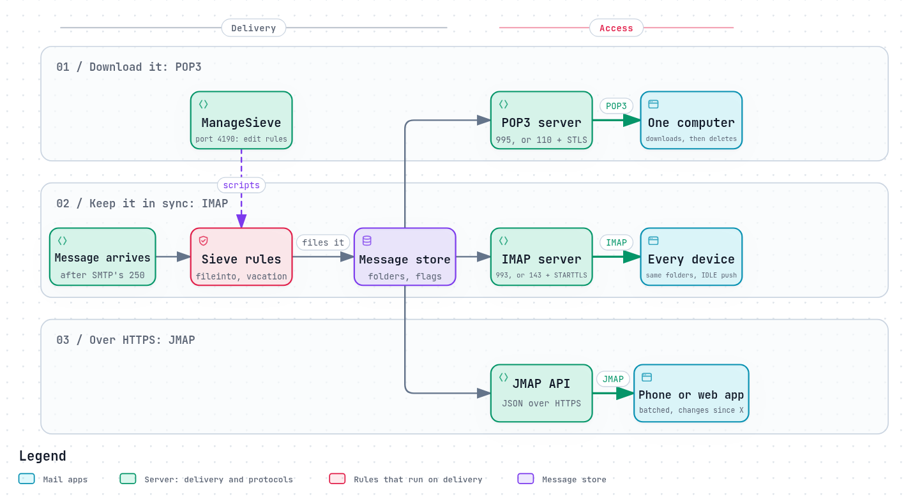

# Reading mail: POP3, IMAP, JMAP and Sieve

SMTP only delivers. It puts a message into Bob's mailbox and stops. Getting it
out again, onto Bob's laptop and phone, is a different job, done by different
protocols, usually by a different program on the server: Dovecot or Cyrus
next to Postfix, for example.

Three protocols do that job, from three eras: POP3 from when mail was read on
one computer, IMAP from when people wanted it everywhere, and JMAP from when
"everywhere" came to mean phones on mobile networks. A fourth standard, Sieve,
runs before any of them, and decides which folder a message goes into.



*The diagram's source is [`reading.workflow.json`](../diagrams/reading.workflow.json).*

## POP3: download it

POP3 ([RFC 1939](https://www.rfc-editor.org/rfc/rfc1939), 1996) is the simplest.
The app signs in, lists the messages, downloads them, and usually deletes them
from the server. There are no folders on the server, no read flags, and no
sync: a message read on the laptop is still unread on the phone, or already
gone from it.

POP3 is still useful for one thing: moving mail off a server into a single
archive. It is on port 110 with `STLS`, or 995 with TLS from the first byte.

## IMAP: keep it on the server

IMAP keeps the mail on the server and lets every app see the same thing:
folders, read and flagged status, and new mail as it arrives. Its current
version is IMAP4rev2 ([RFC 9051](https://www.rfc-editor.org/rfc/rfc9051), 2021);
almost every app and server also speaks the older IMAP4rev1
([RFC 3501](https://www.rfc-editor.org/rfc/rfc3501), 2003). It is on port 143
with `STARTTLS`, or 993 with TLS from the first byte.

IMAP is a conversation of tagged commands, which lets an app send several at
once and match the answers:

```
C: a1 LOGIN bob@example.org app-password
S: a1 OK Logged in
C: a2 SELECT INBOX
S: * 3 EXISTS
S: a2 OK [READ-WRITE] Selected
C: a3 FETCH 3 (FLAGS BODY.PEEK[HEADER.FIELDS (FROM SUBJECT)])
S: * 3 FETCH (FLAGS () BODY[HEADER.FIELDS (FROM SUBJECT)] {52}
S: From: Alice <alice@example.com>
S: Subject: Lunch?
S:
S: )
S: a3 OK Fetch completed
```

Much of what makes IMAP pleasant comes from extensions, each its own RFC. A few
worth knowing:

| Extension | What it does | Standard |
|---|---|---|
| `IDLE` | The server tells the app about new mail as it arrives, instead of the app asking every few minutes | [RFC 2177](https://www.rfc-editor.org/rfc/rfc2177) |
| `UIDPLUS` | Tells the app the ID a message gets when it is saved or copied | [RFC 4315](https://www.rfc-editor.org/rfc/rfc4315) |
| `MOVE` | Moves a message in one step, instead of copy, flag and delete | [RFC 6851](https://www.rfc-editor.org/rfc/rfc6851) |
| `SPECIAL-USE` | Says which folder is Sent, Drafts, Trash or Junk, so apps do not have to guess by name | [RFC 6154](https://www.rfc-editor.org/rfc/rfc6154) |
| `CONDSTORE`, `QRESYNC` | Fast resync: "what changed since I last looked?" | [RFC 7162](https://www.rfc-editor.org/rfc/rfc7162) |
| `QUOTA` | How much space the mailbox has left | [RFC 9208](https://www.rfc-editor.org/rfc/rfc9208) |
| `UTF8=ACCEPT` | Folder names and headers in UTF-8 | [RFC 6855](https://www.rfc-editor.org/rfc/rfc6855) |

IMAP's weak points show on phones. `IDLE` needs a connection held open for each
folder being watched, which a phone's operating system will not keep alive in
the background, and resyncing a big mailbox over a slow network takes many
round trips. That is why phone mail apps from the large providers use their own
protocols, and why JMAP was written.

## JMAP: mail over HTTP

JMAP, the JSON Meta Application Protocol
([RFC 8620](https://www.rfc-editor.org/rfc/rfc8620), and for mail
[RFC 8621](https://www.rfc-editor.org/rfc/rfc8621), 2019), does IMAP's job with
JSON over HTTPS:

- **Batched requests:** many operations in one request, with one round trip.
- **Changes since a state:** the server gives each object type a state string;
  the app asks "what changed since state X?", and gets only that.
- **Push** over a single connection for every folder, by EventSource or
  WebSocket ([RFC 8887](https://www.rfc-editor.org/rfc/rfc8887)), or through a
  phone's own push service.
- **Sending is part of it,** so an app needs one protocol and one sign-in,
  not IMAP plus SMTP.

Servers that implement JMAP include Fastmail, Cyrus IMAP, Stalwart and Apache
James ([jmap.io](https://jmap.io/software/index.html)). Most desktop mail apps
do not speak it yet, so for now it sits alongside IMAP rather than replacing
it. [Efforts to modernise email](../landscape/modernising-email.md)
looks at where it stands.

## Sieve: rules that run on the server

Rules in a mail app ("move newsletters to the Reading folder") only run while
the app is open, on that one device. **Sieve**
([RFC 5228](https://www.rfc-editor.org/rfc/rfc5228)) is a small language for
rules that run on the server, as mail is delivered, so the result is the same
on every device:

```sieve
require ["fileinto", "vacation"];

if header :contains "List-Id" "<announce.example.org>" {
  fileinto "Lists/Announce";
  stop;
}

vacation :days 7 :subject "Away until Monday"
  "I am away, and will reply when I am back.";
```

Sieve is deliberately limited: no loops, no variables unless an extension adds
them, no access to anything but the message. That makes it safe to let every
user write their own. Extensions add the rest: `vacation`
([RFC 5230](https://www.rfc-editor.org/rfc/rfc5230)), `variables`
([RFC 5229](https://www.rfc-editor.org/rfc/rfc5229)), `imap4flags`
([RFC 5232](https://www.rfc-editor.org/rfc/rfc5232)) and others.

**ManageSieve** ([RFC 5804](https://www.rfc-editor.org/rfc/rfc5804)) is the
protocol mail apps use to upload and edit a user's Sieve scripts, usually on
port 4190.

## What goes wrong

- **POP3 on more than one device:** the first device to connect takes the mail.
- **Folder names guessed:** without `SPECIAL-USE`, one app saves sent mail in
  "Sent", another in "Sent Items", and the user sees two folders.
- **Passwords in the clear** on 143 or 110 without `STARTTLS`, or a downgrade
  of it ([Encryption in transit](../security/encryption-in-transit.md)).
- **Rules in the app instead of on the server,** so the phone sees an unsorted
  inbox.
- **Auto-replies that answer mailing lists and bounces,** from a vacation rule
  that ignores RFC 3834 ([Bounces, queues and retries](bounces-queues-retries.md#automatic-replies)).

## How REST Mail handles it

- **IMAP on port 993 only,** encrypted from the first byte, with `IDLE`,
  `MOVE`, `QUOTA`, `UIDPLUS`, `UNSELECT`, `ENABLE` and `UTF8=ACCEPT`. The
  protocol is [`rest-mail/go-imap`](https://github.com/rest-mail/go-imap), a
  server library with a test for each RFC; REST Mail's gateway only supplies
  the mailboxes, from the REST API
  ([`internal/gateway/imap/`](../../../internal/gateway/imap/)). Sent, Drafts
  and Trash are marked with their roles in `LIST`; marking Spam as `\Junk` and
  Archive as `\Archive`, and advertising `SPECIAL-USE`, is
  [#717](https://github.com/rest-mail/rest-mail-server/issues/717). It speaks
  IMAP4rev1; IMAP4rev2 is [#718](https://github.com/rest-mail/rest-mail-server/issues/718).
- **POP3 on port 995 only,** from [`rest-mail/go-pop3`](https://github.com/rest-mail/go-pop3)
  ([`internal/gateway/pop3/`](../../../internal/gateway/pop3/)).
- **Apps that do not ask for UTF-8** get headers rewritten into ASCII, as
  RFC 6855 and RFC 6856 describe
  ([`internal/gateway/rawmsg/downgrade.go`](../../../internal/gateway/rawmsg/downgrade.go)).
- **REST Mail's own apps use the REST API,** over HTTPS, the same niche JMAP
  fills: batched JSON, sending and reading through one API, live updates by
  server-sent events for the webmail
  ([`internal/api/handlers/events.go`](../../../internal/api/handlers/events.go)),
  and push notifications to the iPhone app ([`internal/push/`](../../../internal/push/)).
  It is not JMAP: a JMAP app cannot use it. Supporting JMAP is being designed
  in [#720](https://github.com/rest-mail/rest-mail-server/issues/720).
- **Sieve** runs as a step of each domain's inbound pipeline, with
  [`rest-mail/go-sieve`](https://github.com/rest-mail/go-sieve)
  ([`internal/pipeline/filters/sieve.go`](../../../internal/pipeline/filters/sieve.go)).
  Scripts are edited through the REST API (`GET` and `PUT
  /api/v1/accounts/{id}/sieve`, [`sieve.go`](../../../internal/api/handlers/sieve.go)).
  ManageSieve, so mail apps can edit them too, is
  [#719](https://github.com/rest-mail/rest-mail-server/issues/719).
- **Signing in** from a mail app uses an app password, because an account with
  two-factor authentication cannot sign in to IMAP or POP3 with its own
  password ([Who may send](../security/who-may-send.md)).

## Sources

- POP3: [RFC 1939](https://www.rfc-editor.org/rfc/rfc1939).
- IMAP: [RFC 9051](https://www.rfc-editor.org/rfc/rfc9051) (IMAP4rev2),
  [RFC 3501](https://www.rfc-editor.org/rfc/rfc3501) (IMAP4rev1), and the extensions
  [RFC 2177](https://www.rfc-editor.org/rfc/rfc2177),
  [RFC 4315](https://www.rfc-editor.org/rfc/rfc4315),
  [RFC 6851](https://www.rfc-editor.org/rfc/rfc6851),
  [RFC 6154](https://www.rfc-editor.org/rfc/rfc6154),
  [RFC 7162](https://www.rfc-editor.org/rfc/rfc7162),
  [RFC 9208](https://www.rfc-editor.org/rfc/rfc9208),
  [RFC 6855](https://www.rfc-editor.org/rfc/rfc6855).
- JMAP: [RFC 8620](https://www.rfc-editor.org/rfc/rfc8620),
  [RFC 8621](https://www.rfc-editor.org/rfc/rfc8621),
  [RFC 8887](https://www.rfc-editor.org/rfc/rfc8887),
  [jmap.io: software](https://jmap.io/software/index.html).
- Sieve: [RFC 5228](https://www.rfc-editor.org/rfc/rfc5228),
  [RFC 5229](https://www.rfc-editor.org/rfc/rfc5229),
  [RFC 5230](https://www.rfc-editor.org/rfc/rfc5230),
  [RFC 5232](https://www.rfc-editor.org/rfc/rfc5232),
  ManageSieve [RFC 5804](https://www.rfc-editor.org/rfc/rfc5804).
- REST Mail: [`internal/gateway/imap/`](../../../internal/gateway/imap/),
  [`internal/gateway/pop3/`](../../../internal/gateway/pop3/),
  [`internal/pipeline/filters/sieve.go`](../../../internal/pipeline/filters/sieve.go).
