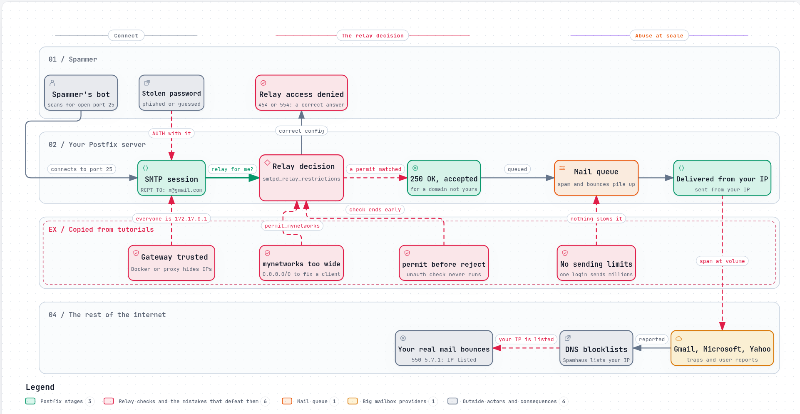

# The open relay and the spam machine

A mail server has to do two things that pull against each other. It must
accept mail from anyone on the internet, because that is how mail for your
domain arrives. And it must refuse to pass mail on to anyone else, unless the
sender is one of your own users. Get the first half wrong and your users miss
mail. Get the second half wrong and strangers use your server to send their
spam.

There are two ways to get it wrong:

- An **open relay** delivers mail for anyone who connects. No password needed.
- A **spam machine** delivers mail for one stolen login, as fast as it can.

Either way, the spam leaves from your server's address, and the rest of the
internet holds you responsible for it.



*The diagram's source is [`open-relay.workflow.json`](../diagrams/open-relay.workflow.json).
On the website it is interactive: it animates, and you can follow any path
through it.*

## The rule every server has to get right

When a client sends `RCPT TO:<someone@example.org>`, the server asks one
question: **is this recipient mine?**

- **Yes**, the domain is one this server hosts: accept it. This is mail
  arriving for your users, and it may come from anyone.
- **No**, the domain belongs to someone else: accept it only from a client
  you trust, or from one of your users who has signed in. Otherwise refuse.

Passing mail on to another server is called **relaying**. A server that relays
for anyone is an open relay. The internet's mail standards have asked servers
not to do this since 1999 ([RFC 2505](https://www.rfc-editor.org/rfc/rfc2505)).

Postfix answers the question with a **restriction list**, evaluated for every
`RCPT TO`. Its default, since Postfix 2.10, is:

```
smtpd_relay_restrictions = permit_mynetworks, permit_sasl_authenticated, defer_unauth_destination
```

Read it left to right:

1. `permit_mynetworks`: if the client's IP address is in `mynetworks`, accept.
2. `permit_sasl_authenticated`: if the client signed in, accept.
3. `defer_unauth_destination`: if the recipient is not ours, refuse.

The **first** rule that matches decides. A `permit` ends the list, and
nothing after it runs. That one fact is behind most of what follows.

Postfix has a safety net: it refuses to receive mail at all unless one of
its restriction lists contains a rejecting rule, such as
`reject_unauth_destination` or `defer_unauth_destination`
([postconf: smtpd_relay_restrictions](https://www.postfix.org/postconf.5.html#smtpd_relay_restrictions)).
The net checks that a rejecting rule *exists*. It cannot check that a `permit`
placed before it will never match a stranger.

## Four ways tutorials break it

Most self-hosted mail servers are assembled from tutorials. Each one copies a
different set of lines, often written for an older Postfix, and each fixes the
problem in front of it. These four mistakes come up again and again.

### 1. `mynetworks` that trusts too much

`permit_mynetworks` exists so that machines on your own network can send
without signing in. A typical story: an application on another server cannot
send mail, a guide says to add its network to `mynetworks`, and the quickest
change that works is:

```
mynetworks = 0.0.0.0/0
```

That trusts every IPv4 address on the internet. Wider-than-intended ranges do
the same thing more quietly: a whole cloud provider's private range, or
`mynetworks_style = class`, which Postfix itself warns "may cause Postfix to
'trust' your entire provider's network"
([postconf: mynetworks_style](https://www.postfix.org/postconf.5.html#mynetworks_style)).

The default is safe in modern Postfix: since 3.0, `mynetworks_style` defaults
to `host`, trusting only the machine itself. But only at
`compatibility_level = 2` or higher. A server upgraded from an older release
often keeps a lower level, and with it the old `subnet` default, which trusts
every machine on the same network
([COMPATIBILITY_README](https://www.postfix.org/COMPATIBILITY_README.html)).

### 2. A gateway that makes every client look local

`permit_mynetworks` judges a client by its IP address. When something forwards
connections to Postfix, Postfix can see the forwarder's address instead of the
real client's:

- **Docker with IPv6:** an IPv6 connection to a container that only has an IPv4
  address is forwarded by Docker's userland proxy, and arrives from the
  network's gateway address (for example `172.17.0.1`). docker-mailserver warns
  that trusting the Docker network "can create an open relay, for instance if
  IPv6 is enabled on the host machine"
  ([docker-mailserver: PERMIT_DOCKER](https://docker-mailserver.github.io/docker-mailserver/latest/config/environment/#permit_docker),
  [IPv6](https://docker-mailserver.github.io/docker-mailserver/latest/config/advanced/ipv6/)).
- **A TCP proxy or load balancer** in front of Postfix, without the PROXY
  protocol, makes every connection come from the proxy.
- **Kubernetes services** do the same by default: with the default
  `externalTrafficPolicy: Cluster`, "the source IP seen in the target container
  is not the original source IP of the client"
  ([Kubernetes: preserving the client source IP](https://kubernetes.io/docs/tasks/access-application-cluster/create-external-load-balancer/#preserving-the-client-source-ip)).

Tutorials for containers often add the container network to `mynetworks`, so
that other containers can send mail. Combine that with any of the above, and
everyone on the internet arrives looking like a trusted local machine.

The fix is to give Postfix the real address, with
`smtpd_upstream_proxy_protocol = haproxy` behind a proxy
([postconf](https://www.postfix.org/postconf.5.html#smtpd_upstream_proxy_protocol)),
and never to trust a gateway's address.

### 3. A `permit` before the reject

Before Postfix 2.10, relay control and spam filtering shared one list,
`smtpd_recipient_restrictions`, which Postfix's own documentation calls
"error-prone configuration"
([postconf: smtpd_relay_restrictions](https://www.postfix.org/postconf.5.html#smtpd_relay_restrictions)).
Any `permit` placed before `reject_unauth_destination` lets a stranger through.

Postfix's documentation gives a real example
([SMTPD_ACCESS_README](https://www.postfix.org/SMTPD_ACCESS_README.html)):

```
smtpd_recipient_restrictions =
    permit_mynetworks
    check_helo_access hash:/etc/postfix/helo_access
    reject_unknown_helo_hostname
    reject_unauth_destination

# /etc/postfix/helo_access
localhost.localdomain PERMIT
```

The exception was meant for one machine that greets with
`HELO localhost.localdomain`. But anyone can send that greeting, and in their
words this makes Postfix "an open relay for all such hosts".

Postfix 2.10 separated the two lists, so this can no longer happen by
accident. But for servers migrating from older versions, the documentation
allows setting `smtpd_relay_restrictions` empty and using
`smtpd_recipient_restrictions` "exactly as before". Tutorials that copy that
line bring the old trap back.

### 4. A stolen password and no limits

`permit_sasl_authenticated` is correct: your users sign in and send. The
trouble starts when a password leaks, through phishing, reuse or guessing. From
then on, a spammer is one of your users.

Postfix does not limit how much a signed-in user sends. Its rate limits are
**per client address**, and off by default:
`smtpd_client_message_rate_limit` defaults to `0`, meaning "a client can send as
many message delivery requests per time unit as Postfix can accept"
([postconf](https://www.postfix.org/postconf.5.html#smtpd_client_message_rate_limit)).
A spammer spreading over many addresses is not slowed at all. Limiting per
account needs a separate policy service, which most tutorials leave out.

## Why age makes it worse

None of these mistakes is a bug in Postfix. Postfix is carefully built and well
documented. The trouble is that every safer default had to be added on top of
older behaviour, without breaking the servers already running it:

- **Safer defaults arrive behind a switch.** `mynetworks_style = host` is the
  default only at `compatibility_level = 2` or higher. An upgraded server keeps
  the older, wider default until someone raises the level by hand
  ([COMPATIBILITY_README](https://www.postfix.org/COMPATIBILITY_README.html)).
- **The old shape stays supported.** Setting `smtpd_relay_restrictions` empty
  brings back the pre-2.10 combined list, "exactly as before"
  ([postconf](https://www.postfix.org/postconf.5.html#smtpd_relay_restrictions)).
- **Tutorials outlive the versions they were written for,** and are copied into
  new servers years later.
- **Every protection added since** (encryption, sign-in, SPF, DKIM, DMARC,
  MTA-STS) is another daemon or setting with its own syntax, each with
  mistakes of its own. Part 2 of this guide goes through them one at a time.

So a server can follow its documentation, start without a warning, and still
relay for strangers. REST Mail starts from the other end. It is one modern
stack in which the safe behaviour is the only behaviour. Compatibility lives at
the edge, where it still speaks SMTP, IMAP and POP3 to everyone, not in a
configuration file that carries every old default forward.

## What it costs

- **Blocklists.** Large mailbox providers and blocklist operators such as
  Spamhaus see spam from your address, and list it.
- **Your real mail bounces.** Servers that check those lists refuse mail from
  your address, so your users' ordinary mail is rejected with `550 5.7.1` until
  you are delisted, which happens only after the server is cleaned up.
- **Your host steps in.** Hosting providers block port 25 or suspend servers
  that send spam.
- **Backscatter.** Spam sent with forged senders bounces back to those senders,
  innocent people who never sent anything
  ([BACKSCATTER_README](https://www.postfix.org/BACKSCATTER_README.html)).

## How to check your own server

From a machine **outside** your network, try to relay through your server:

```
swaks --server mail.example.com --from test@example.net --to someone@gmail.com
```

A correct server refuses the recipient with `454 4.7.1` (the default
`defer_unauth_destination`) or `554 5.7.1` (`reject_unauth_destination`),
both with "Relay access denied". If it answers `250`, it is an open relay.

On the server, read what is actually in effect:

```
postconf -n mynetworks mynetworks_style compatibility_level smtpd_relay_restrictions smtpd_recipient_restrictions
```

Check that `mynetworks` lists only addresses you control, that no `permit`
comes before the rejecting rule, and that a growing queue (`postqueue -p`) is
not your first sign of trouble.

## How REST Mail handles it

REST Mail removes the decision that goes wrong, rather than asking you to
configure it correctly:

- **No trusted networks.** On port 25, REST Mail accepts a recipient only if it
  is a mailbox it hosts; any other recipient is refused with `550 5.1.1`,
  whatever the client's address. There is no `mynetworks` to widen. Repeated
  misses slow the client down.
  ([`internal/gateway/smtp/session.go`](../../../internal/gateway/smtp/session.go), `Rcpt`)
- **Relaying only for users who signed in**, on the submission port, 465, with
  TLS from the first byte. `MAIL FROM` without a login is refused with `530`.
  ([`session.go`](../../../internal/gateway/smtp/session.go), [`server.go`](../../../internal/gateway/smtp/server.go))
- **A real address behind a proxy.** REST Mail reads the client's address
  through the PROXY protocol, only from proxies listed as trusted. Even then,
  an address never grants relaying.
  ([`proxyproto.go`](../../../internal/gateway/smtp/proxyproto.go))
- **Limits per account, on by default.** Each signed-in account has a
  sending rate limit (`451 4.7.1` when exceeded, #171), at most 100 recipients
  per message, and may only send from addresses it owns (`550` otherwise). The
  REST API's send path has the same limits (#184).

The trade-off: an application that wants to send through REST Mail signs in
with an app password, instead of being trusted for its address.

## Sources

- [RFC 2505](https://www.rfc-editor.org/rfc/rfc2505): Anti-Spam Recommendations for SMTP MTAs.
- Postfix: [postconf(5)](https://www.postfix.org/postconf.5.html),
  [SMTPD_ACCESS_README](https://www.postfix.org/SMTPD_ACCESS_README.html),
  [COMPATIBILITY_README](https://www.postfix.org/COMPATIBILITY_README.html),
  [BACKSCATTER_README](https://www.postfix.org/BACKSCATTER_README.html).
- docker-mailserver: [PERMIT_DOCKER](https://docker-mailserver.github.io/docker-mailserver/latest/config/environment/#permit_docker),
  [IPv6](https://docker-mailserver.github.io/docker-mailserver/latest/config/advanced/ipv6/).
- Kubernetes: [preserving the client source IP](https://kubernetes.io/docs/tasks/access-application-cluster/create-external-load-balancer/#preserving-the-client-source-ip).
- REST Mail: [`internal/gateway/smtp/`](../../../internal/gateway/smtp/).
