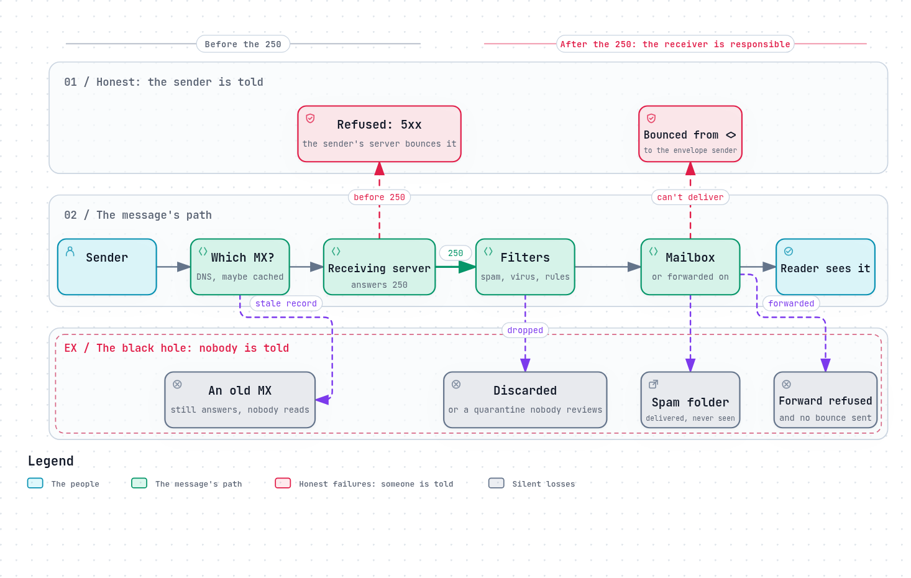

# The black hole: how mail is silently lost

Email has always promised one thing above all: a message is either delivered,
or the sender is told it was not. A bounce is annoying, but it is honest. The
sender knows to try again, or to pick up the phone.

The worst failure is the one that breaks that promise. The message is accepted,
everyone believes it arrived, and it is never seen again. Nobody gets an error,
so nobody looks for one. RFC 5321 is blunt about it: dropping mail without
telling the sender "is extremely dangerous and violates a long tradition and
community expectations that mail is either delivered or returned"
([§6.2](https://www.rfc-editor.org/rfc/rfc5321#section-6.2)).

We have not found a reliable measurement of how much mail is lost this way. By
its nature, it is the failure nobody reports.

*The diagram's source is [`black-hole.workflow.json`](../diagrams/black-hole.workflow.json).*

## Why it happens: responsibility after the 250

The moment a receiving server answers `250` to a message, it takes
responsibility for it ([The journey of a message](../how-email-works/journey-of-a-message.md#5-bobs-server-decides-whether-to-accept-it)).
The sender's server deletes its copy. From then on, if the message is lost,
there is only one server that can say so, and it is the one that lost it.

So every black hole is a server that accepted a message and then did not deliver
it or bounce it. Here are the usual places.

## On the way: the wrong server says yes

- **An old MX still answering.** After a move to a new server, the DNS still
  lists the old one, or some senders have it cached. The old server is still
  running, accepts the mail, and stores it in a mailbox nobody reads any more.
- **A catch-all that goes nowhere:** a server configured to accept mail for any
  address at the domain, and deliver what it does not recognise to a mailbox
  nobody checks, or to nothing.
- **A misconfigured relay or gateway** in front of the real server (a spam
  filtering service, a load balancer) that accepts mail it cannot pass on.

## On the receiving server: accepted, then dropped

- **Filters that discard.** A spam or virus filter that runs after the `250`
  and deletes what it does not like. The alternative, rejecting during the
  conversation, makes the sender's server tell the sender
  ([Spam defences](../security/spam-defences.md#after-the-message-is-it-what-it-claims-and-is-it-wanted)).
- **A quarantine nobody reviews.** Held for an administrator who never looks,
  and expired after a month.
- **The spam folder.** Technically delivered; in practice, for many readers,
  never seen.
- **A full mailbox, or an error writing it,** handled by dropping instead of
  bouncing or retrying.
- **Rules the user forgot:** a Sieve `discard`, or a filter that files mail from
  one sender into a folder nobody opens.

## Forwarding: accepted, then lost downstream

Forwarding adds a second hop after the `250`. When the forward fails (the next
server rejects it for failing SPF or DMARC, see [SPF](../security/spf.md#why-forwarding-breaks-spf)),
the forwarding server must bounce to the original sender
([RFC 5321 §6.1](https://www.rfc-editor.org/rfc/rfc5321#section-6.1)). Many
forwarders do not, and the message is gone.

## Bounces that are lost

A bounce is itself a message, sent with an empty envelope sender
([Bounces, queues and retries](../how-email-works/bounces-queues-retries.md#the-bounce)).
It can be lost too:

- **Sent to the wrong place,** because the original envelope sender was not a
  real address: a `noreply@` that rejects everything.
- **Refused by the sender's own server,** because it treats mail from `<>`
  as spam. RFC 5321 expects servers to accept it: DSNs and similar
  notifications "are required by existing and proposed Standards to be sent
  with a null reverse-path" ([§4.5.5](https://www.rfc-editor.org/rfc/rfc5321#section-4.5.5)).
- **Filed as spam,** because bounces look like backscatter.
- **Never generated,** because the queue gave up without one.

## How to find a lost message

- **Ask the sender for the `Message-ID`, the time and the recipient,** then
  search the logs of every server on the path. Postfix logs one line per step
  with a queue ID (`status=sent`, `status=deferred`, `status=bounced`);
  `grep` for the `Message-ID` first, then follow the queue ID.
- **Read the `Received:` lines** of a copy that did arrive somewhere, for the
  path it took ([The journey of a message](../how-email-works/journey-of-a-message.md#every-hop-leaves-a-trace)).
- **DMARC aggregate reports** show how many messages from your domain each
  large receiver saw, and what it did with them ([DMARC](../security/dmarc.md#reports)).
  A sudden gap is a lead.
- **Check every MX the domain has ever had,** and its cached TTL.

## What a server can do about it

- **Decide before the `250`.** Every check that can run during the conversation
  should: recipients, policy, spam and virus scanning. A refusal is honest.
- **Never discard what you have accepted,** except for mail that is clearly
  fraudulent, as RFC 5321 §6.2 allows, and record it when you do.
- **Make held mail visible:** quarantines with notifications, spam folders the
  user is reminded of.
- **Bounce what cannot be delivered,** to the envelope sender, from `<>`.
- **Keep a trace of every message's fate,** so "where did it go?" has an
  answer.

## How REST Mail handles it

- **Checks run before the `250`.** Unknown recipients are refused during the
  conversation, and the inbound pipeline runs on the message before it is
  answered, so a rejection reaches the sender's server as a refusal
  ([`internal/gateway/smtp/session.go`](../../../internal/gateway/smtp/session.go)).
- **No catch-all.** A recipient is either a mailbox or an alias REST Mail hosts,
  or it is refused.
- **Every message has a trace:** each delivery records which filters ran, what
  each decided, and the final outcome (`delivered`, `queued`, `rejected`,
  `quarantined`, `discarded`, `deferred`), readable through the admin API
  ([`internal/api/handlers/trace.go`](../../../internal/api/handlers/trace.go)).
  A discard, by a filter or by the user's own Sieve rule, is recorded, not
  silent.
- **Quarantine is reported:** each user gets a periodic digest of mail held for
  them ([`internal/digest/`](../../../internal/digest/)).
- **Bounces for REST Mail's own users** go straight into their inbox; a sender
  elsewhere, whose mail a forward failed to deliver, is sent one by mail
  ([#715](https://github.com/rest-mail/rest-mail-server/issues/715)).
- **Not yet right:** mail to a domain that does not exist is retried for days
  instead of failing at
  once ([#713](https://github.com/rest-mail/rest-mail-server/issues/713)), and
  the queue gives up after 3 days rather than the 4–5 RFC 5321 expects
  ([#711](https://github.com/rest-mail/rest-mail-server/issues/711)).

## Sources

- [RFC 5321](https://www.rfc-editor.org/rfc/rfc5321):
  [§4.5.5](https://www.rfc-editor.org/rfc/rfc5321#section-4.5.5) (null reverse-path),
  [§6.1](https://www.rfc-editor.org/rfc/rfc5321#section-6.1) (reliable delivery),
  [§6.2](https://www.rfc-editor.org/rfc/rfc5321#section-6.2) (unwanted messages and silent dropping).
- REST Mail: [`internal/api/handlers/trace.go`](../../../internal/api/handlers/trace.go),
  [`internal/pipeline/`](../../../internal/pipeline/),
  [`internal/gateway/queue/`](../../../internal/gateway/queue/).
