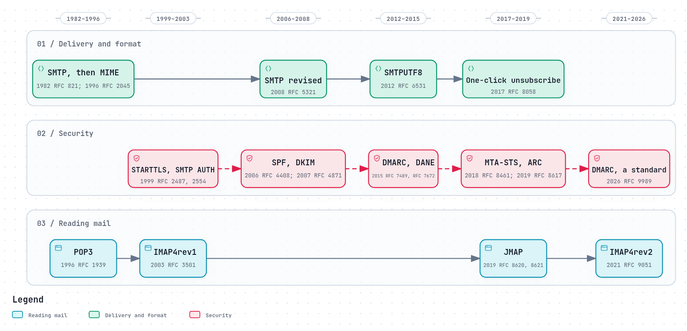

# Efforts to modernise email

Email is older than the web, and almost every part of it has been improved, or
someone has tried. Those efforts fall into two kinds: **upgrades inside the
system**, which every server can adopt one at a time while still talking to the
rest; and **replacements**, which ask everyone to change at once. The first
kind has mostly succeeded. The second has mostly not, for the same reason email
itself has survived: anyone can still send mail to anyone.

*The diagram's source is [`standards.workflow.json`](../diagrams/standards.workflow.json).*

## Upgrades inside the system

**Security, added one layer at a time.** STARTTLS (1999), SPF (2006), DKIM
(2007), DMARC (2015), DANE (2015), MTA-STS and TLS-RPT (2018), ARC (2019), and
DMARC as a standard in 2026. Each closed a real hole while every server that
ignored it kept working. Part 2 of this guide covers each; [Why the security
layers are so hard](../how-it-goes-wrong/why-security-is-hard.md) covers the
cost of having so many.

**Cleartext retired.** [RFC 8314](https://www.rfc-editor.org/rfc/rfc8314) (2018)
declared "Cleartext Considered Obsolete" for mail apps, and the large providers
now refuse ordinary passwords from them
([Who may send](../security/who-may-send.md#passwords-leak-so-use-app-passwords)).

**Mail for every language.** Internationalised email
([RFC 6531](https://www.rfc-editor.org/rfc/rfc6531), 2012, and its companions)
allows addresses and headers in any script, so a user need not have an ASCII
address at all.

**JMAP, a modern protocol for mail apps.** [RFC 8620](https://www.rfc-editor.org/rfc/rfc8620)
and [RFC 8621](https://www.rfc-editor.org/rfc/rfc8621) (2019) replace IMAP's
long-lived connections and many round trips with batched JSON over HTTPS, a
"changes since" model and push. It is implemented by Fastmail, Cyrus IMAP,
Stalwart, Apache James and others, and by a growing list of apps
([jmap.io](https://jmap.io/software/index.html)), but most desktop mail apps
still speak only IMAP ([Reading mail](../how-email-works/reading-mail.md#jmap-mail-over-http)).

**Brand logos: BIMI.** Brand Indicators for Message Identification let a
domain publish a logo that providers may show beside its mail. It is "a display
signal on top of strong authentication": "At a minimum, BIMI requires DMARC
alignment, and many providers also require a valid Certificate (VMC or CMC)
proving rights to the logo" ([BIMI Group](https://bimigroup.org/faqs-for-senders-esps/)).
Its value to the system is that it gives brands a reason to move DMARC to
enforcement.

## End-to-end encryption

Everything above protects mail in transit, between servers. The servers
themselves can read it. Encrypting it so that only the recipient can read it is
an older and harder problem:

- **S/MIME** ([RFC 8551](https://www.rfc-editor.org/rfc/rfc8551), version 4.0 in
  2019) uses certificates from certificate authorities, and is common inside
  organisations that issue them.
- **OpenPGP** ([RFC 9580](https://www.rfc-editor.org/rfc/rfc9580), revised in
  2024) uses keys people manage themselves.
- **Autocrypt** "is a set of guidelines for developers to achieve convenient
  end-to-end-encryption of e-mails", using OpenPGP, in which mail apps exchange
  keys automatically in ordinary messages ([autocrypt.org](https://autocrypt.org/)).
- **Delta Chat** builds a messenger on top of email and Autocrypt, with
  "Audited end-to-end encryption safe against network and server attacks"
  ([delta.chat](https://delta.chat/en/)).

All of them face the same obstacles: finding the recipient's key, managing keys
across devices, and the fact that encrypted mail cannot be searched or filtered
by the server.

## Replacements that did not take hold

- **Internet Mail 2000**, proposed by D. J. Bernstein, turned delivery around:
  "Mail storage is the sender's responsibility", and the receiver picks the
  message up from the sender's server; with each message's delivery status in
  the sender's own archive, "There's no need for bounces"
  ([cr.yp.to/im2000](https://cr.yp.to/im2000.html)). It would also require every
  server and every client to change at once, and it was not adopted.
The lesson: a change that works only when everyone adopts it at once is very
hard to make on an open system where anyone can still send mail to anyone.

## Where REST Mail fits

REST Mail is an upgrade inside the system, not a replacement:

- **It speaks SMTP, IMAP and POP3 to everyone,** so it can replace one server at
  a time without anyone else changing.
- **It adopts every in-system standard** this guide describes, and tracks where
  it does not yet: DANE ([#725](https://github.com/rest-mail/rest-mail-server/issues/725)),
  JMAP ([#720](https://github.com/rest-mail/rest-mail-server/issues/720)),
  reading DMARC reports ([#730](https://github.com/rest-mail/rest-mail-server/issues/730)).
- **Between two REST Mail servers, it upgrades the delivery itself:** the
  [RESTMAIL protocol](restmail-protocol.md) delivers over HTTPS with verified
  endpoints, falling back to ordinary SMTP for everyone else. That is the same
  shape as every successful upgrade before it: better between those who support
  it, compatible with everyone who does not.

## Sources

- The RFCs named above, and in the timeline.
- [jmap.io: software](https://jmap.io/software/index.html).
- [BIMI Group: FAQs for senders](https://bimigroup.org/faqs-for-senders-esps/).
- [autocrypt.org](https://autocrypt.org/), [delta.chat](https://delta.chat/en/).
- D. J. Bernstein: [Internet Mail 2000](https://cr.yp.to/im2000.html).
