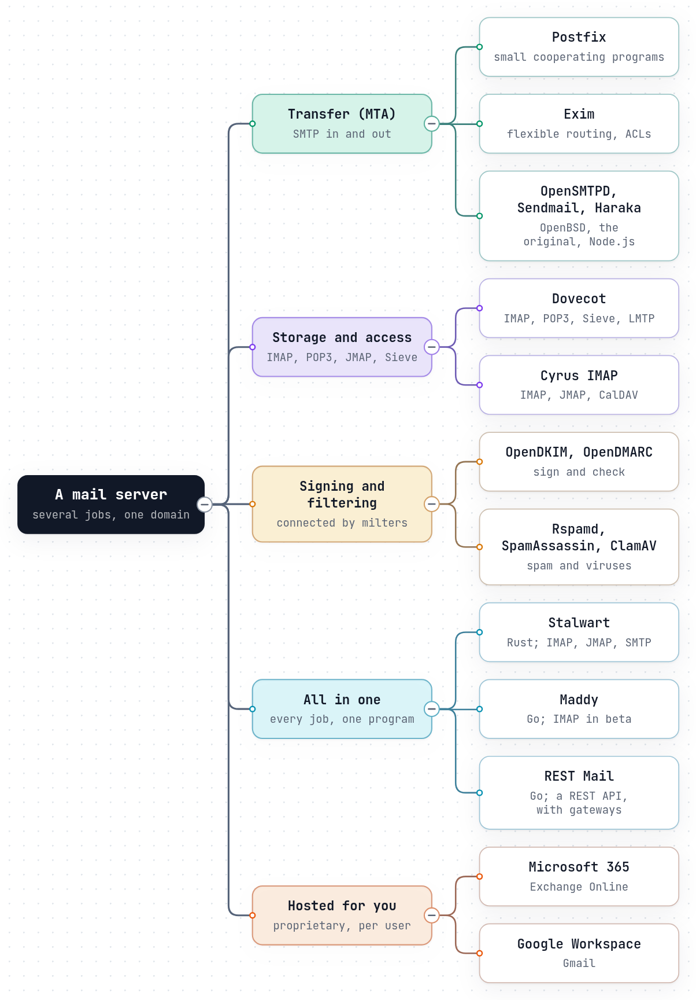

# The servers compared

There is no single "mail server". There are jobs (moving mail between servers,
storing it, serving it to apps, signing it, checking it, filtering it) and
programs that do one or several of them. Most of the internet's mail runs on a
handful of mature open-source programs, combined; a newer generation does all
the jobs in one; and much of the world's mail is handled by a few hosted
services that do all of it for you.

This chapter describes each in its own terms. Every one of them has served
people well, and many of the fixes this guide explains were first written in
them.

*The diagram's source is [`servers.tree.json`](../diagrams/servers.tree.json).*

## The jobs

| Job | What it does | Protocol |
|---|---|---|
| **Transfer (MTA)** | Receives mail from other servers, queues and delivers outgoing mail | SMTP |
| **Submission** | Takes mail from your users' apps, with sign-in | SMTP, port 465/587 |
| **Storage and access** | Keeps mailboxes, serves them to apps, runs Sieve rules | IMAP, POP3, JMAP |
| **Authentication** | Signs outgoing mail, checks SPF, DKIM, DMARC and ARC on incoming | DNS, crypto |
| **Filtering** | Spam and virus scanning, greylisting, blocklists | various |
| **Administration** | Domains, mailboxes, aliases, passwords, keys, certificates | files, SQL, LDAP, web |

## Transfer agents

- **Postfix** is "Wietse Venema's mail server that started life at IBM research
  as an alternative to the widely-used Sendmail program", and "attempts to be
  fast, easy to administer, and secure" ([postfix.org](https://www.postfix.org/)).
  It is built as a set of small cooperating programs, one per step: `smtpd`
  receives, `cleanup` checks, `qmgr` queues, `smtp` delivers
  ([Postfix architecture overview](https://www.postfix.org/OVERVIEW.html)).
  Its documentation is thorough, and much of it is quoted in this guide.
- **Exim** "is a message transfer agent (MTA) originally developed at the
  University of Cambridge [...] There is a great deal of flexibility in the way
  mail can be routed, and there are extensive facilities for checking incoming
  mail" ([exim.org](https://www.exim.org/)). DKIM is built in; SPF and DMARC
  are options when Exim is compiled, using libspf2 and libopendmarc
  ([Exim: DKIM, SPF, SRS and DMARC](https://www.exim.org/exim-html-current/doc/html/spec_html/ch-dkim_spf_srs_and_dmarc.html)).
- **Sendmail** is the program Postfix and Exim were written to replace; "Exim
  can be installed in place of Sendmail" ([exim.org](https://www.exim.org/)).
  Its open-source version is maintained by Proofpoint
  ([Proofpoint](https://www.proofpoint.com/us/products/email-protection/open-source-email-solution)).
- **OpenSMTPD** "is a FREE implementation of the server-side SMTP protocol as
  defined by RFC 5321", "Started out of dissatisfaction with other
  implementations", from the OpenBSD project ([opensmtpd.org](https://www.opensmtpd.org/)).
  Its configuration is short and readable.
- **Haraka** "is an open source SMTP server written in Node.js which provides
  extremely high performance coupled with a flexible plugin system"
  ([haraka.github.io](https://haraka.github.io/)). Every step of the
  conversation can be hooked by a plugin, which makes it popular as a filtering
  front end.

## Mailbox servers

- **Dovecot** is "the world's most trusted open-source email server", in its own
  words "Powering over 75% of the World's Email Servers", first released in 2002
  ([dovecot.org](https://www.dovecot.org/)). It serves IMAP and POP3, stores
  mail, runs Sieve (through Pigeonhole), and usually takes delivery from
  Postfix or Exim over LMTP. It also answers sign-in questions for them.
- **Cyrus IMAP** "is an email, contacts and calendar server", with replication,
  CalDAV and CardDAV ([cyrusimap.org](https://www.cyrusimap.org/)), and is one of
  the JMAP servers ([jmap.io](https://jmap.io/software/index.html)).

## Signing and filtering, alongside

The classic transfer agents leave signing and most checking to separate
programs connected through the **milter** interface: OpenDKIM and OpenDMARC for
DKIM and DMARC, an SPF policy service, [Rspamd](https://rspamd.com/) or
[SpamAssassin](https://spamassassin.apache.org/) for spam, [ClamAV](https://www.clamav.net/)
for viruses, Postgrey for greylisting, Fail2ban for repeated failed sign-ins.
This is flexible, and each piece is good at its job; it is also why a working
server is a set of programs to configure, connect and keep current
([Why the security layers are so hard](../how-it-goes-wrong/why-security-is-hard.md)).

## All in one

A newer generation does every job in one program, with one configuration:

- **Stalwart**, written in Rust: "Secure, scalable mail & collaboration server
  with comprehensive protocol support (IMAP, JMAP, SMTP, CalDAV, CardDAV,
  WebDAV)", with DKIM, SPF, DMARC, ARC, DANE, MTA-STS and spam filtering built in
  ([Stalwart](https://github.com/stalwartlabs/stalwart)). It is dual-licensed,
  AGPL-3.0 or a commercial licence.
- **Maddy**, written in Go: it "replaces Postfix, Dovecot, OpenDKIM, OpenSPF,
  OpenDMARC and more with one daemon with uniform configuration and minimal
  maintenance cost", though its maintainers note that "IMAP storage is "beta""
  ([Maddy](https://github.com/foxcpp/maddy)).

## Hosted services

- **Microsoft 365 (Exchange Online)** and **Google Workspace (Gmail)** run the
  whole stack for you: servers, storage, filtering, authentication, apps, and the
  reputation of very large sending networks. You manage users and DNS records,
  and what the admin console allows. The trade-offs are a per-user price, your
  mail on their servers under their terms, and proprietary systems you cannot
  inspect or change. Both also apply the sender rules every other server has to
  meet ([Bulk mail](../security/bulk-mail.md)).
- **Exchange Server** is Microsoft's on-premises server, for organisations that
  run their own.

## At a glance

| | Language | Transfer | Storage and access | Signing and checking built in | Filtering built in |
|---|---|---|---|---|---|
| Postfix | C | yes | no | no (milters) | some (postscreen) |
| Exim | C | yes | no | DKIM; SPF and DMARC as build options | ACLs |
| OpenSMTPD | C | yes | no | no (filters) | filters |
| Haraka | JavaScript | yes | no | plugins | plugins |
| Dovecot | C | no | IMAP, POP3, Sieve | no | no |
| Cyrus IMAP | C | no | IMAP, POP3, JMAP, Sieve | no | no |
| Stalwart | Rust | yes | IMAP, POP3, JMAP | yes | yes |
| Maddy | Go | yes | IMAP (beta) | yes | some |
| REST Mail | Go | yes | IMAP, POP3, REST API | yes | yes |

Languages are as GitHub reports them for each project's repository.

## How REST Mail fits

REST Mail is in the all-in-one group: one program behind one REST API does
transfer, submission, storage, access, signing, checking and filtering
([What REST Mail does differently](what-rest-mail-does-differently.md)). It
differs from the others in three ways:

- **The REST API is the server.** SMTP, IMAP and POP3 are gateways in front of
  it, and REST Mail's own apps use the API directly.
- **It is built to be safe without configuration,** so that the open relay and
  the black hole cannot be configured in ([The open relay](../how-it-goes-wrong/open-relay-and-spam-machine.md#how-rest-mail-handles-it)).
- **It is still young.** The projects above have years or decades of
  production use; this guide links every place where REST Mail does not yet do
  what the RFCs ask.

## Sources

- [postfix.org](https://www.postfix.org/), [exim.org](https://www.exim.org/),
  [opensmtpd.org](https://www.opensmtpd.org/), [haraka.github.io](https://haraka.github.io/),
  [dovecot.org](https://www.dovecot.org/), [cyrusimap.org](https://www.cyrusimap.org/),
  [Stalwart](https://github.com/stalwartlabs/stalwart), [Maddy](https://github.com/foxcpp/maddy),
  [Proofpoint: Sendmail open source](https://www.proofpoint.com/us/products/email-protection/open-source-email-solution)
  (all read 2026-10-23).
- [jmap.io: software](https://jmap.io/software/index.html).
