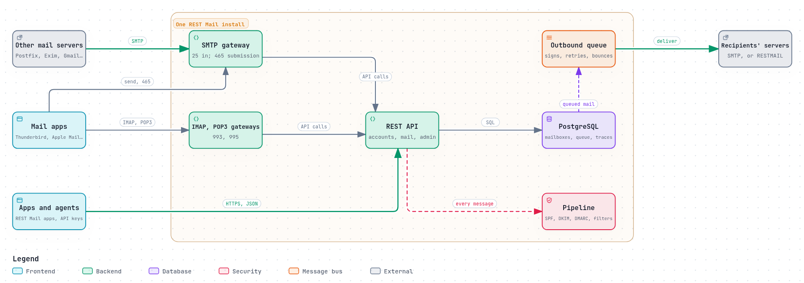

# What REST Mail does differently

Every chapter so far ends with a section on how REST Mail handles its subject.
This chapter steps back and shows the design those sections come from.

The short version: REST Mail is one server with a REST API at its centre. SMTP,
IMAP and POP3 are gateways in front of that API, so every other server and every
mail app sees an ordinary mail server, and REST Mail's own apps, automations and
agents use the API directly. The protections in this guide are built into that
one program, mostly as behaviour rather than as settings.

*The diagram's source is [`rest-mail.architecture.json`](../diagrams/rest-mail.architecture.json).*

## A REST API at the centre

In the classic stack, the mail server is the MTA, and everything else plugs
into it ([The servers compared](servers-compared.md)). In REST Mail, the server
is an HTTP API backed by PostgreSQL: mailboxes, messages, folders, filters,
domains, keys and permissions are all resources in it
([`internal/api/`](../../../internal/api/), [`openapi.yaml`](../../../openapi.yaml)).

- **The protocol gateways** for SMTP, IMAP and POP3 are thin adapters: each wire
  protocol is spoken by a library (`go-smtp`, `go-imap`, `go-pop3`), and the
  gateway turns its commands into API calls
  ([`internal/gateway/`](../../../internal/gateway/)). A server or a mail app
  cannot tell REST Mail from any other mail server.
- **REST Mail's own apps** (the iPhone app, webmail, admin webmail) use the API
  directly, with live updates and push notifications.
- **Automations and agents** use the same API with their own API keys, under the
  same permission system as people ([`internal/auth/api_key.go`](../../../internal/auth/api_key.go)).

## Safe behaviour that is not a setting

The mistakes in [Part 3](../README.md#part-3-how-it-goes-wrong) mostly come from
settings that can be set wrong. REST Mail removes the settings:

| In the classic stack | In REST Mail |
|---|---|
| `mynetworks` decides who may relay | Nobody relays without signing in; there is no trusted network to widen |
| Submission on 587, IMAP on 143, POP3 on 110, with or without TLS | Implicit TLS on 465, 993 and 995 only; no setting for the cleartext ports exists |
| Rate limits off by default, per IP | Limits per account, on by default |
| Any signed-in user may send as anyone, unless configured | Only from addresses the account owns, or holds a grant on |
| DKIM signing through a separate daemon, if configured | Every outbound message signed, or held until it can be |
| DNS records copied from a tutorial | Records generated from the server's state, and checked |
| Mail accepted, then filtered, maybe dropped | Filters run before the `250`; every outcome traced |

## One pipeline for every check

Each domain has an inbound and an outbound pipeline of filters, run in order:
SPF, DKIM, DMARC and ARC checks, greylisting, size and rate limits, spam and
virus scanning through Rspamd and ClamAV, Sieve, vacation replies, webhooks, and
JavaScript filters that run in a sandbox, each in its own QuickJS engine compiled
to WebAssembly, with memory and time limits
([`internal/pipeline/`](../../../internal/pipeline/),
[`docs/adapter-filters.md`](../../adapter-filters.md)). One configuration, one
API, one trace per message.

## One permission system

Everything a person, app or agent may do is a **capability**, granted on an
account or a domain, and checked by the API on every request. Mail apps sign in
with app passwords; accounts with two-factor authentication cannot use their
own password for IMAP, POP3 or SMTP; administrators switch on full rights only
for a while, with a reason, and every administrative action goes into a
hash-chained audit log ([`internal/grants/`](../../../internal/grants/),
[`internal/audit/`](../../../internal/audit/)).

## Compatible with everyone

REST Mail is meant to live alongside the servers it improves on:

- **SMTP, IMAP and POP3** to every other server and app. Each protocol library
  is tested against its RFCs, with a checklist of their requirements; making
  that checklist complete for every library is #374.
- **Passwords stored in Dovecot's `{BLF-CRYPT}` format.** Importing accounts
  with the password hashes they already have is planned
  ([Migrating step by step](migrating.md)).
- **Between two REST Mail servers,** delivery upgrades to HTTPS with the
  [RESTMAIL protocol](restmail-protocol.md), and falls back to SMTP for everyone
  else.
- **Where REST Mail does not yet do what the RFCs ask,** this guide links the
  issue, and the project's rule is to change REST Mail to comply.

## Libraries anyone can use

The protocol and authentication code is split into libraries, each usable on
its own, each MIT-licensed: [`go-smtp`](https://github.com/rest-mail/go-smtp)
(a fork of emersion's), [`go-imap`](https://github.com/rest-mail/go-imap),
[`go-pop3`](https://github.com/rest-mail/go-pop3),
[`go-dkim`](https://github.com/rest-mail/go-dkim),
[`go-spf`](https://github.com/rest-mail/go-spf),
[`go-dmarc`](https://github.com/rest-mail/go-dmarc),
[`go-arc`](https://github.com/rest-mail/go-arc),
[`go-mtasts`](https://github.com/rest-mail/go-mtasts) and
[`go-sieve`](https://github.com/rest-mail/go-sieve).

## What is not done yet

REST Mail is young, and this guide is honest about it. The issues linked from
its chapters cover, among others: queue lifetimes and timeouts to RFC 5321
([#711](https://github.com/rest-mail/rest-mail-server/issues/711),
[#714](https://github.com/rest-mail/rest-mail-server/issues/714)), opportunistic
TLS when sending ([#723](https://github.com/rest-mail/rest-mail-server/issues/723)),
DANE ([#725](https://github.com/rest-mail/rest-mail-server/issues/725)), DMARC to
RFC 9989 ([#729](https://github.com/rest-mail/rest-mail-server/issues/729),
[#730](https://github.com/rest-mail/rest-mail-server/issues/730)), ARC sealing
([#731](https://github.com/rest-mail/rest-mail-server/issues/731)), DKIM rotation
([#728](https://github.com/rest-mail/rest-mail-server/issues/728)), and JMAP
([#720](https://github.com/rest-mail/rest-mail-server/issues/720)).
[Solved, solving, still open](solved-solving-open.md) lists them all.

## Sources

- REST Mail: [`README.md`](../../../README.md), [`docs/MANUAL.md`](../../MANUAL.md),
  [`internal/`](../../../internal/), [`openapi.yaml`](../../../openapi.yaml).
