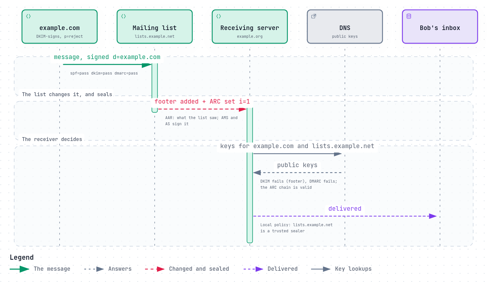

# ARC: authentication that survives forwarding

[SPF](spf.md#why-forwarding-breaks-spf) breaks when a message is forwarded.
[DKIM](dkim.md#what-breaks-a-signature) breaks when a mailing list adds a footer.
And then [DMARC](dmarc.md#why-preject-and-mailing-lists-do-not-mix) fails, and a
domain with `p=reject` asks the final receiver to refuse a message that was
perfectly genuine when it left.

The forwarder or list knew the message was genuine: it checked SPF, DKIM and
DMARC when the message arrived. **ARC**, the Authenticated Received Chain, gives
it a way to write that down, sign it, and pass it on
([RFC 8617](https://www.rfc-editor.org/rfc/rfc8617), 2019, published as
Experimental).



*The diagram's source is [`arc.sequence.json`](../diagrams/arc.sequence.json).*

## Three header lines per hop

Each intermediary that takes part adds an **ARC set**, numbered with `i=`: `1`
for the first, `2` for the next, and so on.

- **`ARC-Authentication-Results`** (AAR): what this hop saw when the message
  arrived, in the same format as `Authentication-Results`, such as `spf=pass
  dkim=pass dmarc=pass`.
- **`ARC-Message-Signature`** (AMS): a DKIM-style signature of the message as
  this hop sends it on, changes included.
- **`ARC-Seal`** (AS): a signature over all the ARC sets so far, with `cv=`,
  this hop's verdict on the chain that arrived: `none` (there was none), `pass`
  or `fail`.

```
ARC-Seal: i=1; a=rsa-sha256; cv=none; d=lists.example.net; s=arc; b=...
ARC-Message-Signature: i=1; a=rsa-sha256; c=relaxed/relaxed; d=lists.example.net; s=arc; h=from:to:subject; bh=...; b=...
ARC-Authentication-Results: i=1; lists.example.net; spf=pass smtp.mailfrom=example.com; dkim=pass header.d=example.com; dmarc=pass header.from=example.com
```

The final receiver checks the chain: every seal valid, every instance present,
the newest message signature matching the message as it is now. If the chain
holds, it knows exactly what each hop claims it saw.

## Claims, not proof

ARC does not prove the original message was genuine. It proves that a
particular intermediary says so. A spammer can run an intermediary and seal
anything. So ARC's results are only as good as the receiver's trust in the
sealer, and the standard leaves that decision to the receiver: "As a matter of
local policy, a DMARC processor MAY choose to accept the authentication
assessments provided by an Authenticated Received Chain"
([RFC 8617 §7.2.1](https://www.rfc-editor.org/rfc/rfc8617#section-7.2.1)).

In practice, receivers trust a short list of sealers they know: large
providers, and the mailing list services their users depend on. Microsoft 365,
for example, lets an administrator name **trusted ARC sealers**, whose recorded
results it then uses "in email authentication checks"
([Microsoft Learn](https://learn.microsoft.com/en-us/defender-office-365/email-authentication-arc-configure)).

## Where ARC fits

- **Forwarders and mailing lists** should seal, so the mail they pass on can be
  judged on what it was.
- **Receivers** should verify, and use the results from sealers they trust when
  DMARC fails. When they do override a policy that way, DMARC reports have a
  place to say so (`PolicyOverride`, [RFC 9990](https://www.rfc-editor.org/rfc/rfc9990)).
- **Senders** need do nothing.

## What goes wrong

- **Sealing without checking:** an intermediary that records `pass` for
  everything makes its seals worthless.
- **Changing the message after sealing,** for example a footer added by a later
  step, breaks the newest message signature.
- **Trusting every valid chain,** which lets anyone who runs a sealer bypass
  DMARC.
- **Not sealing at all,** so forwarded mail fails DMARC at the next hop with no
  evidence to rescue it.

## How REST Mail handles it

- **Verifying:** the `arc_verify` filter validates any ARC chain on incoming
  mail, with [`rest-mail/go-arc`](https://github.com/rest-mail/go-arc)
  ([`internal/pipeline/filters/arc_verify.go`](../../../internal/pipeline/filters/arc_verify.go)).
- **Using it:** when DMARC fails and the chain's latest sealer is on a domain's
  list of trusted sealers, the DMARC policy is overridden and the override is
  reported, as RFC 8617 and the DMARC reports describe. The list is empty by
  default (#178), so nothing is trusted until an administrator decides to.
- **Sealing:** mail a Sieve `redirect` forwards leaves with an ARC set, sealed
  last, with the forwarding domain's DKIM key, over the bytes that leave. Its
  `ARC-Authentication-Results` are the SPF, DKIM, ARC and DMARC results REST Mail
  recorded when the message arrived, and its `cv=` is what `arc_verify` found:
  `none` for the first set, `pass` for a valid chain, `fail` for a broken one. A
  chain that arrived with `cv=fail` is passed on with no new set (RFC 8617 §5.1)
  ([`internal/outbound/arc.go`](../../../internal/outbound/arc.go),
  [#731](https://github.com/rest-mail/rest-mail-server/issues/731)). A domain
  whose DKIM key is Ed25519 forwards unsealed, as go-arc seals with RSA alone.

## Sources

- [RFC 8617](https://www.rfc-editor.org/rfc/rfc8617): The Authenticated Received Chain (ARC) Protocol.
- [RFC 9990](https://www.rfc-editor.org/rfc/rfc9990): DMARC aggregate reporting, including policy overrides.
- Microsoft: [Configure trusted ARC sealers](https://learn.microsoft.com/en-us/defender-office-365/email-authentication-arc-configure).
- REST Mail: [`internal/pipeline/filters/arc_verify.go`](../../../internal/pipeline/filters/arc_verify.go),
  [`internal/pipeline/filters/dmarc_check.go`](../../../internal/pipeline/filters/dmarc_check.go),
  [`rest-mail/go-arc`](https://github.com/rest-mail/go-arc).
