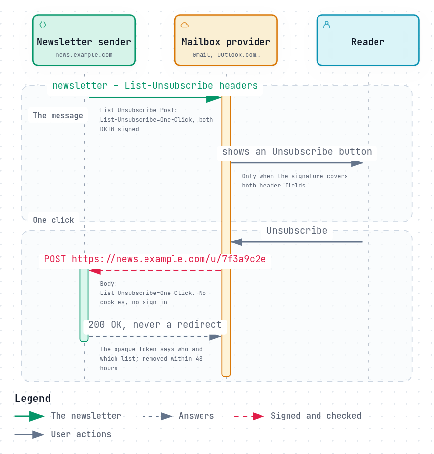

# Bulk mail: List-Unsubscribe and the 2024 sender rules

Most mail is not written by a person to a person. Receipts, password resets,
newsletters, notifications and marketing are sent by machines, in bulk, and
much of what people call spam is mail they once agreed to and can no longer
stop. In 2024 the largest mailbox providers turned years of advice into rules,
and began enforcing them.



*The diagram's source is [`unsubscribe.sequence.json`](../diagrams/unsubscribe.sequence.json).*

## The rules

In October 2023, Google announced that "By February 2024, Gmail will start to
require that bulk senders", those who send more than 5,000 messages a day to
Gmail addresses, authenticate their mail, offer one-click unsubscribe, and keep
complaints low. Yahoo joined in: in the same announcement, its Marcel Becker
said Yahoo looked forward to working with Google "to make these common sense,
high-impact changes the new industry standard"
([Google, 2023](https://blog.google/products/gmail/gmail-security-authentication-spam-protection/)).
Gmail's current guidelines
([Email sender guidelines](https://support.google.com/a/answer/81126),
[FAQ](https://support.google.com/a/answer/14229414)):

**Every sender, at any volume:**

- SPF or DKIM.
- Valid forward and reverse DNS for sending addresses.
- TLS for sending.
- Messages formatted according to RFC 5322.
- A spam rate, as reported in Postmaster Tools, below 0.3%.

**Senders of 5,000 or more messages a day to Gmail, in addition:**

- SPF **and** DKIM.
- A DMARC record, where `p=none` is enough.
- The `From:` domain aligned with SPF or DKIM ([DMARC](dmarc.md#alignment)).
- One-click unsubscribe for marketing and subscribed messages, and an
  unsubscribe link in the body.
- Unsubscribe requests honoured within 48 hours.

Microsoft followed for Outlook.com: from May 5, 2025, domains sending more
than 5,000 messages a day must pass SPF, DKIM and DMARC, and mail that does not
is rejected with `550 5.7.515`
([Microsoft, 2025](https://techcommunity.microsoft.com/blog/microsoftdefenderforoffice365blog/strengthening-email-ecosystem-outlook%E2%80%99s-new-requirements-for-high%E2%80%90volume-senders/4399730)).

And the rules are being enforced: "Starting November 2025, Gmail is ramping up
its enforcement on non-compliant traffic. Messages that fail to meet the email
sender requirements will experience disruptions, including temporary and
permanent rejections" ([Google FAQ](https://support.google.com/a/answer/14229414)).

## List-Unsubscribe

The `List-Unsubscribe` header field has existed since 1998
([RFC 2369](https://www.rfc-editor.org/rfc/rfc2369)). It tells a mail app how to
unsubscribe, so the app can offer a button next to the sender's name instead of
the reader hunting for a link in small print:

```
List-Unsubscribe: <mailto:unsubscribe@news.example.com?subject=u-7f3a>, <https://news.example.com/u/7f3a9c2e>
```

A `mailto:` target unsubscribes by sending mail to it. An `https:` target used to
mean "open this page", which often led to a page asking the reader to confirm,
sign in, or tick boxes: one more chance to give up.

## One-click

[RFC 8058](https://www.rfc-editor.org/rfc/rfc8058) (2017) makes it one click. The
sender adds a second header field:

```
List-Unsubscribe-Post: List-Unsubscribe=One-Click
```

and the mailbox provider, when the user presses its "Unsubscribe" button, sends
an HTTPS `POST` with the body `List-Unsubscribe=One-Click` straight to the URL.
No page, no confirmation. The rules that make it safe (§3.1, §4):

- **The URL identifies the recipient and the list by itself,** and "SHOULD
  include an opaque identifier or another hard-to-forge component", so nobody
  can unsubscribe others by guessing.
- **The `POST` carries nothing else:** "The POST request MUST NOT include
  cookies, HTTP authorization, or any other context information."
- **No redirects:** "The mail sender MUST NOT return an HTTPS redirect."
- **It must be DKIM-signed:** the message "MUST have a valid DomainKeys
  Identified Mail (DKIM) signature that covers at least the List-Unsubscribe
  and List-Unsubscribe-Post headers", so a forger cannot attach an unsubscribe
  URL to someone else's mail.
- **Only with the user's consent:** the provider "MUST NOT perform a POST on the
  HTTPS URI without user consent" (§3.2), so a link-scanning filter must not
  trigger it.

## What goes wrong

- **No `List-Unsubscribe-Post`,** or an `https` target that answers the `POST`
  with a redirect or a confirmation page.
- **Unsigned unsubscribe headers,** or a DKIM signature that does not cover
  them.
- **Unsubscribe requests honoured slowly,** or not at all, so the reader
  presses "Report spam" instead, which raises the spam rate.
- **Transactional mail mixed with marketing** on one domain and one sending
  address, so complaints about the newsletter hurt the delivery of password
  resets.
- **Spam rate above 0.3%:** Gmail stops offering delivery support, and mail
  starts going to spam or being refused.

## How REST Mail handles it

- **Unsubscribe on the send API:** `POST /api/v1/messages/send` takes
  `list_unsubscribe: {mailto, https}`, at most one address and one HTTPS URL that
  the sender runs. REST Mail publishes them as `List-Unsubscribe`, and only an
  `https` target adds `List-Unsubscribe-Post: List-Unsubscribe=One-Click`. It
  never fetches or posts to the URL itself
  ([`internal/api/handlers/list_unsubscribe.go`](../../../internal/api/handlers/list_unsubscribe.go), #144).
- **Signed, as RFC 8058 requires:** both fields are covered by the DKIM
  signature. A one-click target from a domain with no DKIM key is refused
  (`422 dkim_required`), because it could not be signed.
- **Checked:** a target with a line break, a space, credentials, another scheme
  or anything that could inject a header line is refused with `400`.
- **A policy per domain:** a domain marked `bulk` must include
  `list_unsubscribe` on every send, and one marked `transactional` must not
  (`422`), which keeps the two kinds of mail apart. SMTP submission, draft
  sending and forwarding are not yet held to the policy.
- **The rest of the list above** is covered elsewhere: DKIM on every message,
  SPF and DMARC records printed for every domain, TLS whenever the receiver
  offers it, and reverse DNS listed among the records to publish.

## Sources

- Google: [New Gmail protections for a safer, less spammy inbox (2023)](https://blog.google/products/gmail/gmail-security-authentication-spam-protection/),
  [Email sender guidelines](https://support.google.com/a/answer/81126),
  [Email sender guidelines FAQ](https://support.google.com/a/answer/14229414) (read 2026-10-23).
- Microsoft: [Outlook's new requirements for high-volume senders (2025)](https://techcommunity.microsoft.com/blog/microsoftdefenderforoffice365blog/strengthening-email-ecosystem-outlook%E2%80%99s-new-requirements-for-high%E2%80%90volume-senders/4399730).
- [RFC 2369](https://www.rfc-editor.org/rfc/rfc2369): List-Unsubscribe and the other list header fields.
- [RFC 8058](https://www.rfc-editor.org/rfc/rfc8058): Signaling One-Click Functionality for List Email Headers.
- REST Mail: [`internal/api/handlers/list_unsubscribe.go`](../../../internal/api/handlers/list_unsubscribe.go),
  [`internal/outbound/prepare.go`](../../../internal/outbound/prepare.go).
