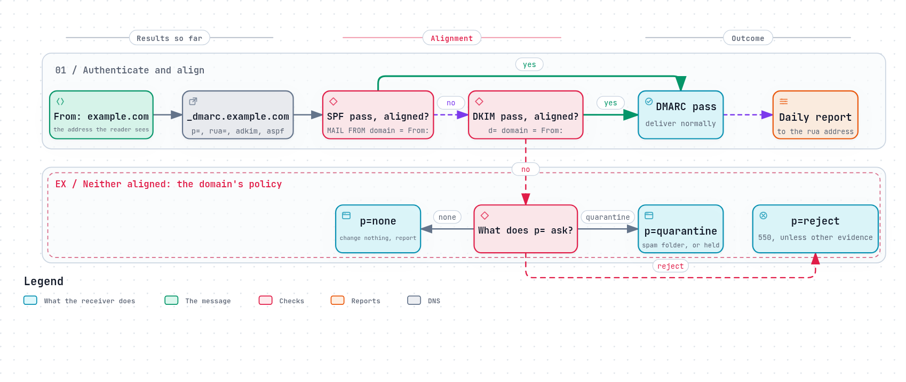

# DMARC: protecting the From line

[SPF](spf.md) checks the envelope sender. [DKIM](dkim.md) checks whichever
domain signed. Neither checks the one address the reader actually sees: the
`From:` line. A phishing message can pass both, with its own domain, while its
`From:` says `security@yourbank.example`.

**DMARC**, Domain-based Message Authentication, Reporting and Conformance,
closes that gap. It says: a message whose `From:` is in my domain must pass SPF
or DKIM **for my domain**, and here is what to do with one that does not. It was
published in 2015 as an informational document
([RFC 7489](https://www.rfc-editor.org/rfc/rfc7489)), and became an IETF
standard in May 2026 as [RFC 9989](https://www.rfc-editor.org/rfc/rfc9989), with
its reports in [RFC 9990](https://www.rfc-editor.org/rfc/rfc9990) and
[RFC 9991](https://www.rfc-editor.org/rfc/rfc9991).



*The diagram's source is [`dmarc.workflow.json`](../diagrams/dmarc.workflow.json).*

## Alignment

DMARC's central idea is **alignment**: the domain that passed SPF or DKIM must be
the `From:` domain, or belong to the same organisation.

- **SPF aligns** when the `MAIL FROM` domain matches the `From:` domain.
- **DKIM aligns** when a valid signature's `d=` matches the `From:` domain.

A message passes DMARC if **at least one** of them passes and aligns. Two
strictness levels exist, set separately for each (`aspf=`, `adkim=`):

- **Relaxed** (the default): the same organisation is enough.
  `bounces.example.com` aligns with `example.com`.
- **Strict:** the names must be identical.

## The record

```
_dmarc.example.com.  TXT  "v=DMARC1; p=quarantine; rua=mailto:dmarc-reports@example.com"
```

| Tag | Meaning |
|---|---|
| `p=` | What the domain asks receivers to do with mail that fails: `none`, `quarantine` or `reject` |
| `sp=` | The same, for subdomains that exist |
| `np=` | The same, for subdomains that do not exist (new in RFC 9989) |
| `rua=` | Where to send daily aggregate reports |
| `ruf=` | Where to send reports about single failing messages |
| `adkim=`, `aspf=` | Relaxed (`r`) or strict (`s`) alignment |
| `t=y` | Testing: apply one level less than the stated policy (new in RFC 9989) |
| `psd=` | Whether this is a public suffix domain such as a registry (new in RFC 9989) |

RFC 9989 also **removed** three tags: `pct` (apply the policy to a percentage of
mail), which "was usually not accurately applied" (Appendix A.6), and `rf` and
`ri`. Receivers ignore them now.

## The three policies

- **`p=none`:** do nothing different, but send reports. This is how every domain
  should start: "discovered policies of "p=none" MUST NOT modify existing mail
  handling processes" ([RFC 9989 §5.4](https://www.rfc-editor.org/rfc/rfc9989#section-5.4)).
- **`p=quarantine`:** treat failing mail as suspicious, usually the spam folder.
- **`p=reject`:** refuse failing mail during the SMTP conversation.

The policy is a request, not a command: "The final handling of any message is
always a matter of local policy and is left to the discretion of the Mail
Receiver" (§5.4).

## Reports

The `rua` address receives one XML report a day from each receiver that supports
them: how many messages claimed your domain, from which addresses, and whether
they passed SPF, DKIM and DMARC ([RFC 9990](https://www.rfc-editor.org/rfc/rfc9990)).
They are how a domain finds the mail it forgot about (the invoicing system, the
newsletter tool) before tightening its policy, and how it sees who is forging
its name.

## Why p=reject and mailing lists do not mix

A mailing list resends a member's message to every subscriber, with the
member's `From:`. It sends from its own server, so SPF does not align; and it
usually adds a footer or a `[list]` tag, so the DKIM signature breaks
([DKIM](dkim.md#what-breaks-a-signature)). The message fails DMARC at every
subscriber's server, through no fault of anyone.

This became visible in April 2014, when Yahoo published `p=reject` for
`yahoo.com`. John Levine explained to the IETF what followed: "Lists generally
modify messages via subject tags, body footers, attachment stripping, and other
useful features that break the DKIM signature. So on even the most legitimate
list mail like, say, the IETF's, most of the mail fails the DMARC assertions",
and subscribers' servers rejected it
([PCWorld, 2014](https://www.pcworld.com/article/444768/yahoo-email-antispoofing-policy-breaks-mailing-lists.html)).
Worse, list software saw those rejections as bounces, and unsubscribed people
who had done nothing wrong ([RFC 7960](https://www.rfc-editor.org/rfc/rfc7960)).

The new standard draws the conclusion for both sides:

- **For domains:** "domains that host users who might post messages to mailing
  lists SHOULD NOT publish Domain Owner Assessment Policies of "p=reject"". A
  domain that wants it anyway should publish `p=none` for at least a month, then
  `p=quarantine` for as long, and compare the reports first
  ([RFC 9989 §7.4](https://www.rfc-editor.org/rfc/rfc9989#section-7.4)).
- **For receivers:** they "SHOULD NOT reject messages solely because of a
  published policy of "reject" but [...] apply other knowledge and analysis"
  (§5.4).

Mailing lists adapted too, by rewriting the `From:` line of posts from such
domains ("Alice via the List"), and [ARC](arc.md) lets a list vouch for what a
message looked like when it arrived.

## Who requires it

Since February 2024, Gmail requires DMARC of anyone sending it more than 5,000
messages a day, though `p=none` is enough, and requires the `From:` domain to
align with SPF or DKIM
([Google, Email sender guidelines](https://support.google.com/a/answer/81126)).
Outlook.com has required the same of senders above 5,000 a day since May 5,
2025 ([Microsoft, 2025](https://techcommunity.microsoft.com/blog/microsoftdefenderforoffice365blog/strengthening-email-ecosystem-outlook%E2%80%99s-new-requirements-for-high%E2%80%90volume-senders/4399730)).
See [Bulk mail](bulk-mail.md).

## What goes wrong

- **Jumping straight to `p=reject`,** before the reports show every legitimate
  source passing, and before thinking about mailing lists.
- **Services that send as you without aligning:** a newsletter tool that signs
  with its own `d=` and uses its own bounce domain passes SPF and DKIM, but not
  DMARC for your domain.
- **`rua` pointing at a mailbox nobody reads.** The reports are the point of
  `p=none`.
- **Forgetting subdomains:** without `sp=` or `np=`, `p=` applies to every
  subdomain, including ones invented by a forger.
- **Relying on SPF alone** under `p=reject`: forwarding breaks SPF, so "domains
  that publish "p=reject" MUST NOT rely solely on SPF [...] and MUST apply valid
  DKIM signatures" (§7.4).

## Check your own domain

```sh
dig +short TXT _dmarc.example.com
```

Then read an aggregate report, or send yourself a message at another provider
and look for `dmarc=pass` in its `Authentication-Results`.

## How REST Mail handles it

- **Incoming mail:** the `dmarc_check` filter combines the SPF and DKIM results
  and applies the `From:` domain's policy: `reject` refuses with `550`,
  `quarantine` holds the message, `none` changes nothing
  ([`internal/pipeline/filters/dmarc_check.go`](../../../internal/pipeline/filters/dmarc_check.go),
  [`rest-mail/go-dmarc`](https://github.com/rest-mail/go-dmarc)). It follows
  RFC 9989: the policy and each domain's organisation come from the DNS tree
  walk, a subdomain that does not exist gets `np`, and a record in test mode
  (`t=y`) is applied one level lower. A failure that a trusted ARC sealer
  vouches for is let through, and a `p=reject` failure that came through a
  mailing list (it carries `List-Id`) is quarantined rather than refused,
  since a list breaks the authentication RFC 9989 relies on; each such
  departure from the policy is reported, with its reason. Other `p=reject`
  failures are still refused.
- **Reports:** REST Mail sends RFC 9990 aggregate reports to every address a
  domain asks for, one report per policy domain
  ([`internal/dmarcreport/`](../../../internal/dmarcreport/)).
- **Your domain's record:** `chore dns:show` prints a DMARC record with the
  domain's own policy, `dmarc_policy` in the admin API. A new domain starts at
  `p=none`, so its reports come in from the first day and no one's delivery
  changes. An admin raises it to `quarantine`, then `reject`, once the reports
  show the domain's mail passes, as RFC 9989 §7.4 advises, and leaves a domain
  whose users write to mailing lists below `reject`. REST Mail always signs with
  DKIM, which `p=reject` requires
  ([#729](https://github.com/rest-mail/rest-mail-server/issues/729)).
- **The standard:** REST Mail implements RFC 9989 and RFC 9990: no Public
  Suffix List, no `pct`. A subdomain gets `np` when DNS answers NXDOMAIN for
  it ([RFC 8020](https://www.rfc-editor.org/rfc/rfc8020)); Go's resolver
  reports NXDOMAIN and an empty answer alike, so REST Mail asks the DNS servers
  itself and reads the response code
  ([`nxdomain.go`](../../../internal/nxdomain/nxdomain.go)). Receiving aggregate reports for REST Mail's own
  domains is still to come
  ([#730](https://github.com/rest-mail/rest-mail-server/issues/730)).

## Sources

- [RFC 9989](https://www.rfc-editor.org/rfc/rfc9989): DMARC (May 2026).
  [RFC 9990](https://www.rfc-editor.org/rfc/rfc9990): aggregate reporting.
  [RFC 9991](https://www.rfc-editor.org/rfc/rfc9991): failure reporting.
  [RFC 7489](https://www.rfc-editor.org/rfc/rfc7489): the 2015 original, now obsolete.
- [RFC 7960](https://www.rfc-editor.org/rfc/rfc7960): DMARC and indirect email flows.
- PCWorld: [Yahoo email anti-spoofing policy breaks mailing lists (2014)](https://www.pcworld.com/article/444768/yahoo-email-antispoofing-policy-breaks-mailing-lists.html).
- Google: [Email sender guidelines](https://support.google.com/a/answer/81126).
- Microsoft: [Outlook's new requirements for high-volume senders (2025)](https://techcommunity.microsoft.com/blog/microsoftdefenderforoffice365blog/strengthening-email-ecosystem-outlook%E2%80%99s-new-requirements-for-high%E2%80%90volume-senders/4399730).
- REST Mail: [`internal/pipeline/filters/dmarc_check.go`](../../../internal/pipeline/filters/dmarc_check.go),
  [`internal/dmarcreport/`](../../../internal/dmarcreport/),
  [`internal/dns/mail_records.go`](../../../internal/dns/mail_records.go).
