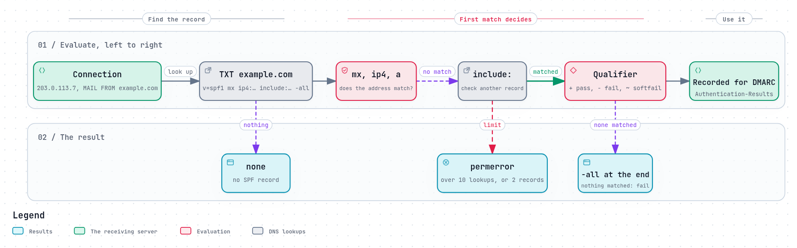

# SPF: which servers may send for a domain

Nothing in SMTP stops a server from saying `MAIL FROM:<ceo@example.com>` when it
has nothing to do with `example.com`. For decades, receivers had no way to tell.

**SPF**, the Sender Policy Framework, gives the domain a way to say which
servers may send its mail. It is a single DNS record, and the receiving server
checks the connecting address against it
([RFC 7208](https://www.rfc-editor.org/rfc/rfc7208), 2014, after the
experimental [RFC 4408](https://www.rfc-editor.org/rfc/rfc4408) of 2006).



*The diagram's source is [`spf.workflow.json`](../diagrams/spf.workflow.json).*

## The record

```
example.com.  TXT  "v=spf1 mx ip4:203.0.113.0/24 include:_spf.mailer.example -all"
```

Read it left to right, as a receiver does:

1. **`mx`**: the domain's own MX servers may send.
2. **`ip4:203.0.113.0/24`**: so may any address in this range (`ip6:` for IPv6).
3. **`include:_spf.mailer.example`**: so may any server the newsletter service
   lists in its own SPF record.
4. **`-all`**: nobody else.

The **first** term that matches the connecting address decides. Each term can
carry a **qualifier** saying what a match means: `+` pass (the default), `-`
fail, `~` softfail ("probably not, but do not reject on this alone"), `?`
neutral. So `-all` at the end means "everything else fails", and `~all` means
"everything else is suspicious".

The other terms are `a` (the domain's own addresses), `exists` (a DNS name built
from the sender and the connecting address, for special cases), `redirect=` (use another domain's record
instead), and `ptr`, which "SHOULD NOT be published"
([§5.5](https://www.rfc-editor.org/rfc/rfc7208#section-5.5)), because it is
slow and unreliable.

## What gets checked

SPF checks two identities, both from the SMTP conversation, not from the
message:

- **`MAIL FROM`**, the envelope sender: the main check.
- **`HELO`**, the name the client greeted with. RFC 7208 recommends checking it
  too, and first ([§2.3](https://www.rfc-editor.org/rfc/rfc7208#section-2.3)).
  For a bounce, which has an empty `MAIL FROM`, it is the only identity.

The result is one of seven ([§2.6](https://www.rfc-editor.org/rfc/rfc7208#section-2.6)):

| Result | Meaning |
|---|---|
| `pass` | The address is allowed to send for the domain |
| `fail` | The domain says it is not |
| `softfail` | The domain says probably not |
| `neutral` | The domain makes no statement about this address |
| `none` | The domain has no SPF record |
| `temperror` | A DNS problem; try again later |
| `permerror` | The record is broken: a syntax error, or too many lookups |

Note what SPF does **not** check: the `From:` line the reader sees. A message can
pass SPF for `MAIL FROM:<bounces@mailer.example>` while its `From:` says
`ceo@example.com`. Tying the two together is [DMARC](dmarc.md)'s job.

## The 10-lookup limit

Each `include`, `a`, `mx`, `ptr`, `exists` and `redirect` costs the receiver a
DNS query, and an include can include others. To keep that bounded, "SPF
implementations MUST limit the total number of those terms to 10 during SPF
evaluation [...] If this limit is exceeded, the implementation MUST return
"permerror"" ([§4.6.4](https://www.rfc-editor.org/rfc/rfc7208#section-4.6.4)).
Lookups that find nothing ("void lookups") should be limited to two.

This is the most common way a well-meaning domain breaks its own SPF. Every
service it sends through (a newsletter tool, a helpdesk, a CRM, the office suite)
asks to be included, each include brings its own lookups, and one day the
eleventh pushes the record into `permerror`. Everything then fails SPF, the
domain's own mail included.

## Why forwarding breaks SPF

Bob forwards his mail from `bob@old.example` to `bob@new.example`. A message from
Alice arrives at `old.example`, and is passed on to `new.example` with Alice's
envelope sender unchanged, as forwarding traditionally does
([RFC 5321 §3.9.1](https://www.rfc-editor.org/rfc/rfc5321#section-3.9.1)). Now
`new.example` sees a message claiming to be from `example.com`, arriving from
`old.example`'s server, which is not in `example.com`'s SPF record. SPF fails,
through no one's fault.

Two fixes exist:

- **SRS, the Sender Rewriting Scheme:** the forwarder rewrites the envelope
  sender to an address of its own, so SPF is checked against the forwarder's
  domain, and bounces come back to the forwarder, which passes them on. SRS is
  not an RFC; for Postfix it is usually added with
  [PostSRSd](https://github.com/roehling/postsrsd).
- **[ARC](arc.md):** the forwarder records that the message passed SPF when it
  arrived, and signs that record, so the final receiver can choose to trust it.

## What goes wrong

- **More than 10 lookups,** so SPF is a `permerror` for everything.
- **Two SPF records** on one name: that is a `permerror` too
  ([§3.2](https://www.rfc-editor.org/rfc/rfc7208#section-3.2)).
- **`+all`,** which allows the whole internet, or `?all`, which says nothing.
- **`~all` forever,** published as a first step and never tightened.
- **A new mail service, not added,** whose mail then fails SPF.
- **IPv6 forgotten:** the server sends over IPv6 and only its IPv4 address is
  listed.
- **No SPF record at all.** A 2023 study of the top 10 million domains found
  that "only about 40% of sites publish SPF"
  ([Blechschmidt and Stock, USENIX Security 2023](https://www.usenix.org/conference/usenixsecurity23/presentation/blechschmidt)).

A domain that sends no mail at all should still publish `v=spf1 -all`, so that
nobody can use it.

## Check your own domain

```sh
dig +short TXT example.com | grep spf1      # exactly one record
dig +short TXT _spf.mailer.example          # and each include, for its own lookups
```

Count every `include`, `a`, `mx`, `ptr`, `exists` and `redirect`, following
includes into the records they name. The total must be 10 or fewer.

## How REST Mail handles it

- **The record it asks you to publish** is `v=spf1 mx -all`: the domain's MX may
  send, nothing else. It names the MX rather than an address, so moving the
  server changes one A record and nothing else
  ([`internal/dns/mail_records.go`](../../../internal/dns/mail_records.go)).
- **Incoming mail** is checked by the `spf_check` filter, for both the `HELO`
  and the `MAIL FROM` identity, with [`rest-mail/go-spf`](https://github.com/rest-mail/go-spf),
  which enforces the 10-lookup and 2-void-lookup limits
  ([`internal/pipeline/filters/spf_check.go`](../../../internal/pipeline/filters/spf_check.go)).
- **SPF alone does not reject, by default.** The result is recorded for DMARC,
  which decides with the `From:` domain's own policy. A domain can make an SPF
  `fail` reject or quarantine instead, with the filter's `fail_action`.
- **The result is written into the message,** as an `Authentication-Results`
  field ([RFC 8601](https://www.rfc-editor.org/rfc/rfc8601)), and any field that
  arrived claiming to be from this server is removed first, so a sender cannot
  forge a pass ([`internal/mime/authresults.go`](../../../internal/mime/authresults.go)).
- **Forwarding:** REST Mail's Sieve redirects keep the original envelope sender,
  so forwarded mail can fail SPF at the next hop. Rewriting it with SRS, and
  bouncing failed forwards correctly, is discussed in
  [#715](https://github.com/rest-mail/rest-mail-server/issues/715).

## Sources

- [RFC 7208](https://www.rfc-editor.org/rfc/rfc7208): Sender Policy Framework (SPF), version 1.
  [RFC 4408](https://www.rfc-editor.org/rfc/rfc4408): the 2006 experimental version.
- [RFC 5321 §3.9](https://www.rfc-editor.org/rfc/rfc5321#section-3.9): aliases and forwarding.
- [RFC 8601](https://www.rfc-editor.org/rfc/rfc8601): Authentication-Results.
- Blechschmidt and Stock: [Extended Hell(o), USENIX Security 2023](https://www.usenix.org/conference/usenixsecurity23/presentation/blechschmidt).
- REST Mail: [`internal/pipeline/filters/spf_check.go`](../../../internal/pipeline/filters/spf_check.go),
  [`rest-mail/go-spf`](https://github.com/rest-mail/go-spf).
