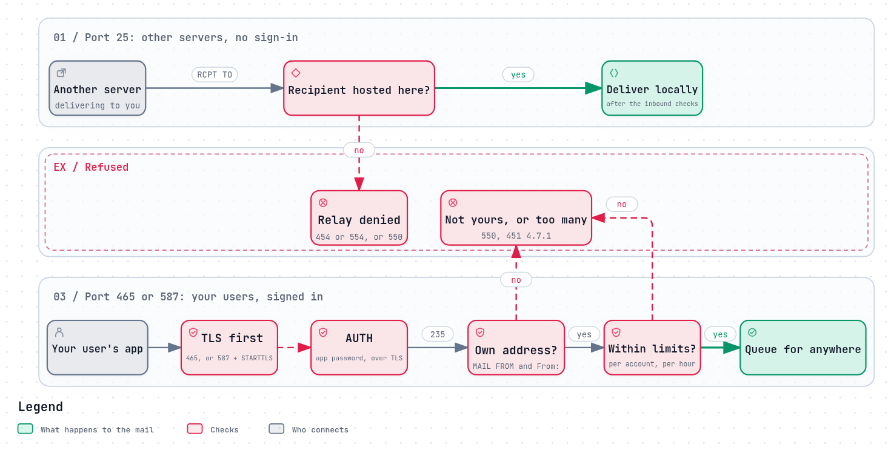

# Who may send: SMTP AUTH, SASL and app passwords

A mail server takes mail from two kinds of client, and must treat them
completely differently:

- **Other servers,** delivering mail to your users. Anyone in the world may do
  this, without signing in, but only for addresses you host.
- **Your own users,** sending mail anywhere in the world. Only they may do this,
  and the server has to know who they are.

Mixing the two up is how a server becomes an
[open relay](../how-it-goes-wrong/open-relay-and-spam-machine.md). Keeping them
apart is the job of separate ports, a sign-in, and limits on what a signed-in
user may do.



*The diagram's source is [`who-may-send.workflow.json`](../diagrams/who-may-send.workflow.json).*

## Two doors

Until the late 1990s, mail apps sent mail the same way servers did, on port 25,
and servers decided who to relay for by IP address. As people started sending
from home connections, hotels and phones, addresses stopped meaning anything.
The fix was to give users their own door: **message submission**
([RFC 6409](https://www.rfc-editor.org/rfc/rfc6409), first published as [RFC 2476](https://www.rfc-editor.org/rfc/rfc2476) in 1998),
on port 587, or 465 with TLS from the first byte
([RFC 8314](https://www.rfc-editor.org/rfc/rfc8314)).

On the submission door, signing in is required: "The MSA MUST, by default,
issue an error response to the MAIL command if the session has not been
authenticated" ([RFC 6409 §4.3](https://www.rfc-editor.org/rfc/rfc6409#section-4.3)).
On port 25, the server is an MX: it accepts mail only for its own domains, and
need not offer sign-in at all.

## How signing in works: SMTP AUTH and SASL

SMTP's sign-in is the `AUTH` command
([RFC 4954](https://www.rfc-editor.org/rfc/rfc4954)). It does not define how to
prove who you are; it borrows that from **SASL**, the Simple Authentication and
Security Layer ([RFC 4422](https://www.rfc-editor.org/rfc/rfc4422)), which IMAP
and POP3 use too. The server lists the methods it accepts, and the client picks
one:

```
S: 250-AUTH PLAIN LOGIN
C: AUTH PLAIN AGJvYkBleGFtcGxlLm9yZwBzZWNyZXQ=
S: 235 2.7.0 Authentication successful
```

| Mechanism | How it works | Notes |
|---|---|---|
| `PLAIN` | Sends the username and password, base64-encoded (not encrypted) | Safe only inside TLS ([RFC 4616](https://www.rfc-editor.org/rfc/rfc4616)) |
| `LOGIN` | The same, in two steps | Never standardised, but almost every app supports it |
| `SCRAM-SHA-256` | Proves knowledge of the password without sending it | [RFC 7677](https://www.rfc-editor.org/rfc/rfc7677); fewer apps support it |
| `OAUTHBEARER`, `XOAUTH2` | Sends a token from a separate sign-in, often in a browser | [RFC 7628](https://www.rfc-editor.org/rfc/rfc7628); used by Gmail and Microsoft 365 |

`PLAIN` is the most common, and its own standard warns that it "should not be
used without adequate data security protection as this mechanism affords no
integrity or confidentiality protections itself"
([RFC 4616 §1](https://www.rfc-editor.org/rfc/rfc4616#section-1)). Over implicit
TLS on 465, that protection is there from the first byte.

## Passwords leak, so use app passwords

A mail app stores the password and sends it on every connection, for years. If
it is the same password the user signs in to everything else with, one leak
gives a spammer the account, and with it the right to send anywhere. Spamhaus
has called stolen SMTP passwords "a major vector for criminal spam"
([Spamhaus, 2012](https://www.spamhaus.org/news/article/681/spam-through-compromised-passwords-can-it-be-stopped)),
and in 2024 still keeps a dedicated blocklist for it
([Spamhaus, 2024](https://www.spamhaus.org/resource-hub/email-security/a-misuse-of-spamhaus-blocklists-part-2-how-to-limit-outbound-spam/)).

Mail protocols also cannot ask for a second factor: there is no place in
`AUTH PLAIN` for a code from an authenticator app. The common answer is the
**app password**: a long, random password, made for one app or device, which
can be revoked without changing anything else. The large providers have moved
away from ordinary passwords for mail apps entirely:

- **Google** turned off sign-in with an account's ordinary password for IMAP,
  POP and SMTP apps on March 14, 2025; such apps now need OAuth or an app
  password ([Google Workspace Admin Help](https://knowledge.workspace.google.com/admin/sync/transition-from-less-secure-apps-to-oauth)).
- **Microsoft** turned off Basic authentication for POP, IMAP and most other
  protocols in Exchange Online from October 1, 2022, and disabled SMTP AUTH in
  tenants that were not using it
  ([Microsoft Learn](https://learn.microsoft.com/en-us/exchange/clients-and-mobile-in-exchange-online/deprecation-of-basic-authentication-exchange-online)).

## After sign-in: what a user may do

Signing in answers "who are you?", not "what may you do?". A server still needs
to check:

- **That the sender address is theirs.** A signed-in user who may put any
  address in `MAIL FROM` and `From:` can impersonate everyone else on the server,
  and anyone else at all. Spamhaus recommends "disallowing sending from domains
  whose mail you do not host".
- **That they are within their limits:** messages per hour, recipients per
  message. Spamhaus recommends "default per-account limits on numbers of
  outgoing emails" (both from [Spamhaus, 2024](https://www.spamhaus.org/resource-hub/email-security/a-misuse-of-spamhaus-blocklists-part-2-how-to-limit-outbound-spam/)).
  A stolen password is then a nuisance, not a disaster.
- **That nobody is guessing.** Bots try common passwords on every submission
  and IMAP server they find. Locking out an address after a few failures, with
  tools such as fail2ban, keeps that slow.

## What goes wrong

- **`AUTH` offered on port 25.** Servers never sign in to each other, so the only
  ones using it there are password-guessing bots.
- **`AUTH` before TLS,** on 587 or 143 without `STARTTLS`, so passwords cross the
  network readable.
- **One password for everything:** the account, the mail app, the printer and
  the website's contact form.
- **No per-account limits,** so a single stolen login sends millions of messages
  ([The open relay and the spam machine](../how-it-goes-wrong/open-relay-and-spam-machine.md#4-a-stolen-password-and-no-limits)).
- **Trusting an application by its address** (`mynetworks`) instead of giving it
  its own login.
- **Letting a user send as anyone,** because the sender address is never checked.

## How REST Mail handles it

- **Two doors, enforced.** Port 25 never offers `AUTH` (`503 5.5.1 AUTH not
  available on this port`), and accepts mail only for mailboxes it hosts. Port
  465 is implicit TLS, offers `AUTH PLAIN` and `AUTH LOGIN`, and refuses `MAIL
  FROM` before sign-in with `530`
  ([`internal/gateway/smtp/session.go`](../../../internal/gateway/smtp/session.go)).
- **One sign-in path for every protocol.** SMTP, IMAP and POP3 all check a
  password through the same API call, `POST /api/v1/auth/protocol-sign-in`, so the
  rules are the same everywhere.
- **App passwords:** named, revocable, for mail apps and automations, usable
  over IMAP, POP3, SMTP and the REST API. An account with two-factor
  authentication can only sign in to mail apps with one; its own password is
  refused ([`internal/auth/app_password.go`](../../../internal/auth/app_password.go)).
- **Only your own addresses.** A signed-in account may send only from addresses
  it owns, or ones it holds a `mail:send` grant on; anything else is refused with
  `550`. An app password sends only as its own address.
- **Limits per account, on by default:** 20 messages a minute and 100 an hour on
  submission, and at most 100 recipients per message
  ([`internal/ratelimit/submission.go`](../../../internal/ratelimit/submission.go)).
- **Guessing is slowed:** after 5 failed sign-ins from one address within 10
  minutes, that address is banned for 30 minutes; bans can also be made
  permanent, by hand or from fail2ban
  ([`internal/gateway/connlimiter/`](../../../internal/gateway/connlimiter/),
  [`docs/fail2ban-setup.md`](../../fail2ban-setup.md)).
- **Not offered:** `SCRAM-SHA-256` and OAuth sign-in.

## Sources

- [RFC 6409](https://www.rfc-editor.org/rfc/rfc6409): Message Submission for Mail.
  [RFC 8314](https://www.rfc-editor.org/rfc/rfc8314): implicit TLS for submission.
- [RFC 4954](https://www.rfc-editor.org/rfc/rfc4954): SMTP AUTH.
  [RFC 4422](https://www.rfc-editor.org/rfc/rfc4422): SASL.
  [RFC 4616](https://www.rfc-editor.org/rfc/rfc4616): PLAIN.
  [RFC 7677](https://www.rfc-editor.org/rfc/rfc7677): SCRAM-SHA-256.
  [RFC 7628](https://www.rfc-editor.org/rfc/rfc7628): OAUTHBEARER.
- Spamhaus: [2012](https://www.spamhaus.org/news/article/681/spam-through-compromised-passwords-can-it-be-stopped),
  [2024](https://www.spamhaus.org/resource-hub/email-security/a-misuse-of-spamhaus-blocklists-part-2-how-to-limit-outbound-spam/).
- Google: [Transition from less secure apps to OAuth](https://knowledge.workspace.google.com/admin/sync/transition-from-less-secure-apps-to-oauth).
- Microsoft: [Deprecation of Basic authentication in Exchange Online](https://learn.microsoft.com/en-us/exchange/clients-and-mobile-in-exchange-online/deprecation-of-basic-authentication-exchange-online).
- REST Mail: [`internal/gateway/smtp/`](../../../internal/gateway/smtp/),
  [`internal/auth/`](../../../internal/auth/),
  [`internal/ratelimit/`](../../../internal/ratelimit/).
